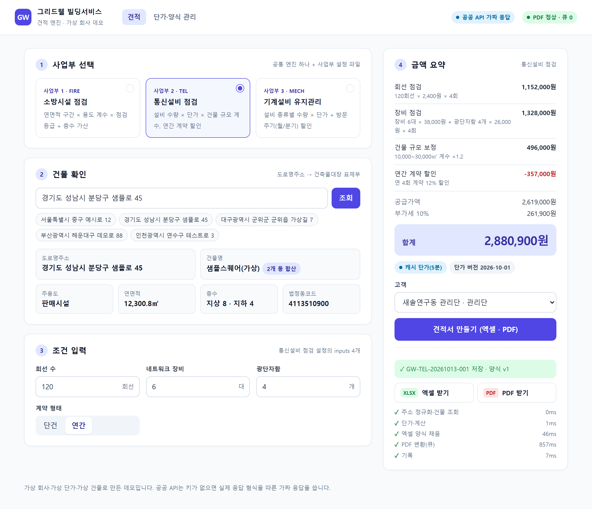

# building-mgmt-dx-airtable

> 개발 조직이 없는 건물관리 회사에서, 흩어진 현장 데이터를 에어테이블 구조로 묶고 → 그 위에 견적 도구를 얹고 → 자동화로 운영을 돌린 과정을, **가상 회사로 다시 구현한 저장소**입니다.

[](https://github.com/workzeroai/building-mgmt-dx-airtable/actions/workflows/ci.yml)


> **작성 중(임시 README)** — 케이스 스터디 본문·구조 도면·데모 GIF는 다음 단계에서 채웁니다. 지금은 견적 엔진(`quote-engine/`)과 에어테이블 데이터 설계·자동화(`airtable/`, `n8n/`)가 들어 있습니다.

*회사 "그리드웰 빌딩서비스(Gridwell Building Services)"는 지어낸 가상 회사입니다. 단가·계수·양식·고객·건물·견적은 모두 생성 스크립트로 만든 가상 데이터이며, 실제 회사·고객과 무관합니다.*



## 빠른 실행 (API 키 불필요)

```bash
git clone https://github.com/workzeroai/building-mgmt-dx-airtable.git && cd building-mgmt-dx-airtable
npm ci
npm run quote:demo
```

3개 사업부(소방시설 점검 · 통신설비 점검 · 기계설비 유지관리) 견적을 한 번에 만들고(xlsx, LibreOffice가 있으면 PDF), 단가 폴백·스테이징 ID 가드·PDF 서킷브레이커·오류 요약 알림을 차례로 시연합니다. 웹 화면은 `npm start` → http://localhost:3000.

```bash
npm run airtable:create-base   # 에어테이블 Base 4개 생성 요청(dry-run, 토큰 불필요)
npm run airtable:check         # 스키마 YAML ↔ 문서·시드·스크립트·n8n·견적 엔진 계약 일관성
```

## 구성

| 폴더 | 내용 | 상태 |
|---|---|---|
| [`quote-engine/`](quote-engine/) | 견적 엔진: 공통 엔진 + 사업부 설정 + 데이터 3층 분리, 안전장치 | 구현 |
| [`data/`](data/) | 데이터 계약(`schema/`), 번들 단가(`pricing/`), 가상 시드(`seed/`) | 구현 |
| [`airtable/`](airtable/) | 에어테이블 데이터 설계(스키마 YAML 단일 출처, 허브 1 + 사업부 Base 3), Base 생성 스크립트, 자동화 스크립트 4개 + 하네스 | 구현 |
| [`n8n/`](n8n/) | 허브 → 사업부 동기화 안전장치 워크플로(스크립트와 같은 판정) | 구현 |
| [`docs/`](docs/) | [데이터 계약](docs/data-contract.md) · [에어테이블 스키마](docs/schema.md) · [사업부 추가 절차](docs/adding-a-division.md) · 도면 · 스크린샷 | 일부 |

## 라이선스

MIT
