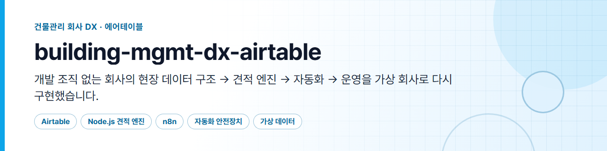
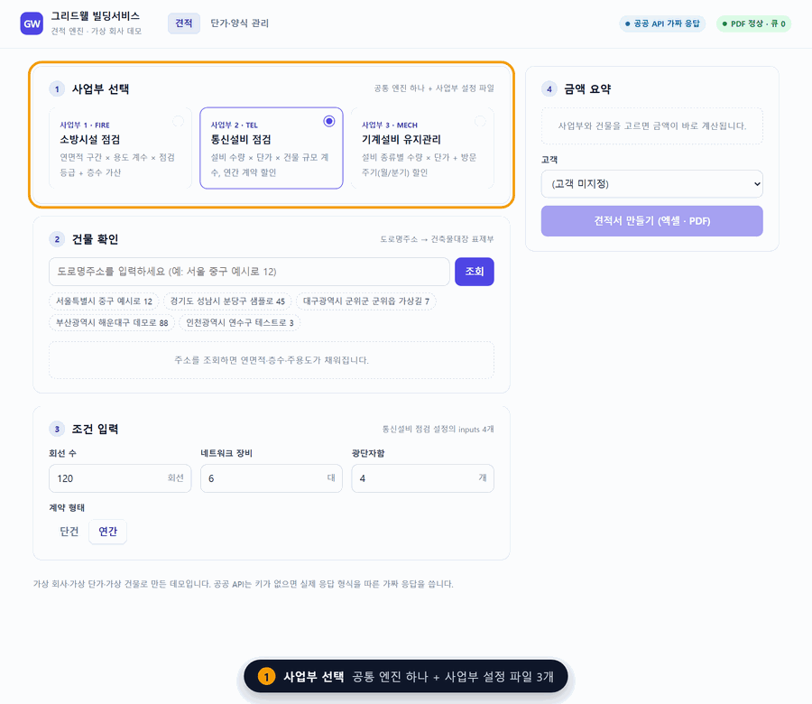
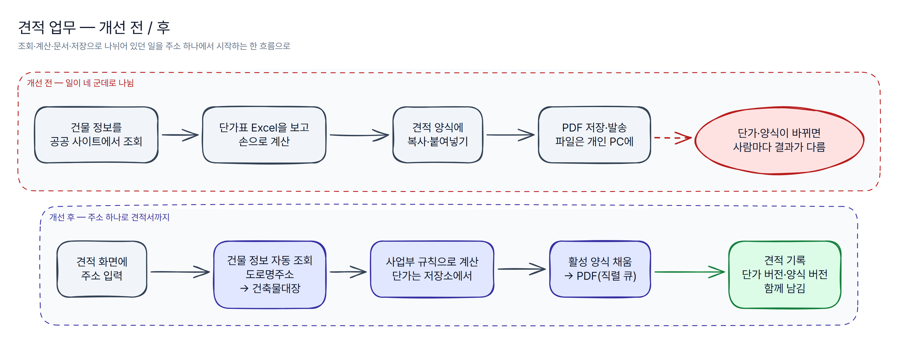
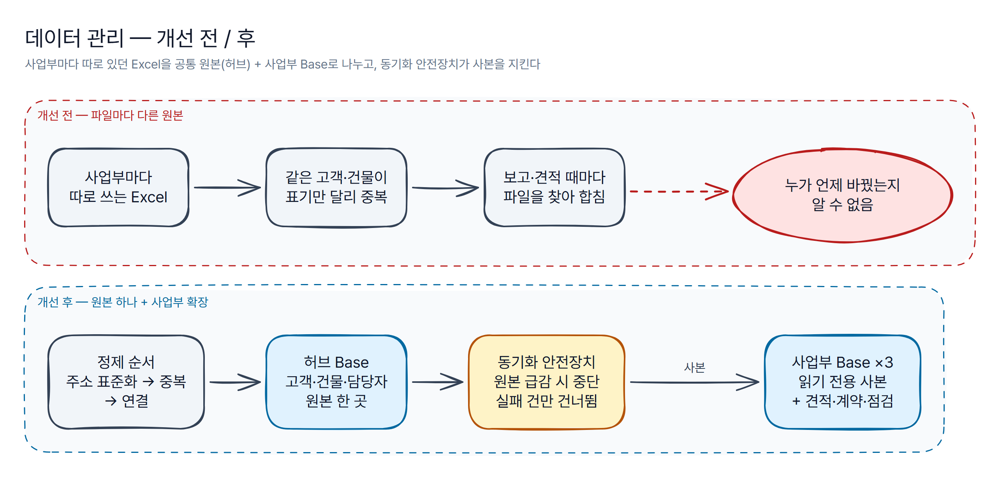
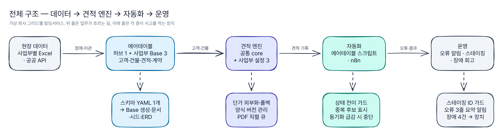
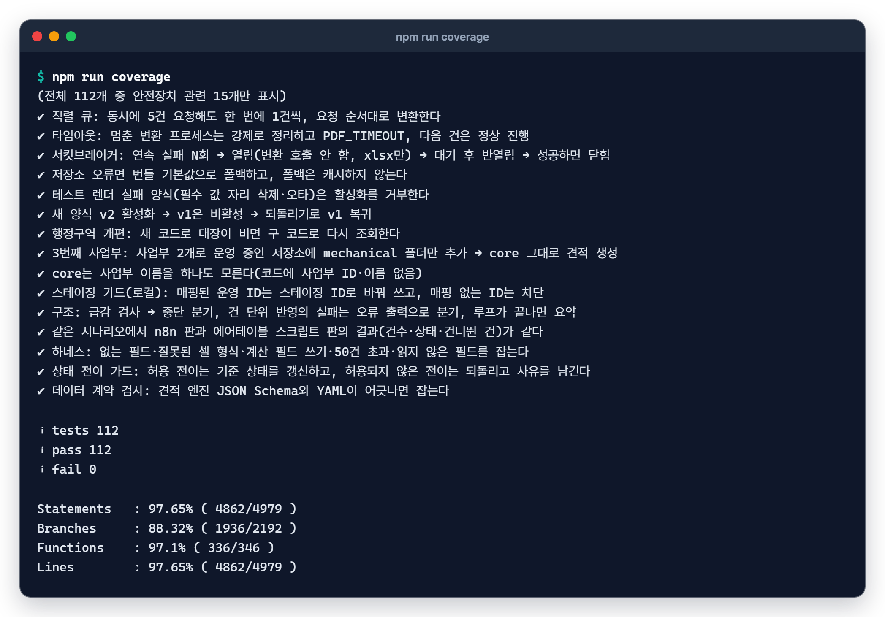

# building-mgmt-dx-airtable

> 개발 조직이 없는 건물관리 회사에서, **흩어진 현장 데이터를 에어테이블 구조로 묶고 → 그 위에 견적 도구를 얹고 → 자동화로 운영을 돌린 과정**을 가상 회사로 다시 구현한 저장소입니다. 데이터 설계·견적 엔진·자동화·운영 회고를 한 사람이 설계하고 구현했습니다.

*English summary is at the [bottom](#english-summary).*

[](https://github.com/workzeroai/building-mgmt-dx-airtable/actions/workflows/ci.yml)




*회사 "그리드웰 빌딩서비스(Gridwell Building Services)"는 지어낸 가상 회사입니다. 단가·계수·양식·고객·건물·견적은 모두 생성 스크립트로 만든 가상 데이터이며 실제 회사·고객과 무관합니다. 공공 API(도로명주소·건축물대장)는 키가 없으면 실제 응답 형식을 따른 가짜 응답을 씁니다.*

## 문제 (Why)

- **현장 데이터가 사업부마다 다른 Excel에 흩어져 있다.** 같은 고객·건물이 파일마다 표기만 달리 중복되고, 보고나 견적 때마다 파일을 찾아 합친다. 누가 언제 무엇을 바꿨는지 남지 않는다.
- **견적 한 건이 조회·계산·문서·저장 네 군데로 나뉘어 있다.** 공공 사이트에서 건물 정보를 찾고, 단가표를 보며 손으로 계산하고, 양식에 옮겨 적고, PDF를 개인 PC에 저장한다. 단가나 양식이 바뀌면 사람마다 결과가 달라진다.
- **개발 조직이 없다.** 만드는 사람과 운영하는 사람이 같다. 그래서 기능보다 **현업이 직접 고칠 수 있는 구조**와 **장애가 나도 업무가 멈추지 않는 장치**가 먼저다.

### 개선 전 / 후





<!-- 도면 원본: docs/diagrams/*.excalidraw (excalidraw.com 또는 Obsidian에서 편집) · 사양: *.yaml -->

## 전체 구조



```text
building-mgmt-dx-airtable/
├─ airtable/            # 데이터 설계: 스키마 YAML(단일 출처) → Base 생성·문서·시드·ERD, 자동화 스크립트 4개 + 하네스
├─ quote-engine/        # 견적 엔진(Node.js·Express): 공통 core + 사업부 설정 3개 + 안전장치, 견적·관리자 화면
├─ n8n/                 # 허브 → 사업부 동기화 안전장치 워크플로(에어테이블 스크립트와 같은 판정)
├─ data/                # 데이터 계약(JSON Schema)·번들 단가·가상 시드(생성 스크립트 산출물)
├─ docs/                # 운영 방식·장애 회고·데이터 계약·스키마 표·사업부 추가 절차·도면·스크린샷
├─ scripts/             # README 이미지 다시 만들기
└─ .github/workflows/   # CI: 린트 → 스키마 파생물 → 테스트·커버리지 → Base 생성 dry-run → 견적 데모
```

## 파트별 요약

### 1. 데이터 설계 — 공통 원본 하나 + 사업부 확장

허브 Base 1개(고객·건물·담당자 원본)와 사업부 Base 3개(같은 틀 + 사업부 고유 필드)로 나눴습니다. 사업부 Base의 고객·건물은 허브의 읽기 전용 사본이고, 코드가 읽는 필드는 영문 이름으로 고정했습니다. 구조 전체를 **YAML 하나**로 정의해 Base 생성 요청·테이블 문서·CSV 시드·ERD·자동화 설정을 만들고, 견적 엔진의 데이터 계약과 어긋나면 테스트가 실패합니다.


→ [`airtable/`](airtable/) · [설계 원칙](airtable/principles.md) · [테이블·필드 표](docs/schema.md) · [데이터 계약](docs/data-contract.md)

### 2. 견적 엔진 — 주소 하나로 견적서까지

주소를 넣으면 **건물 정보 조회 → 사업부 규칙으로 계산 → 엑셀 양식 채움 → PDF → 기록**까지 한 흐름으로 돕니다. 공통 엔진(core)은 사업부 이름을 모르고, 사업부는 설정 파일(입력 항목·계산 함수·엑셀 매핑)로만 붙습니다. 세 번째 사업부(기계설비)는 **설정 파일과 단가 파일 2개만 추가**해 붙였고, 테스트가 core 파일이 바뀌지 않았음을 확인합니다.

| 견적 화면: 조건을 바꾸면 금액이 바로, 만들면 엑셀·PDF·기록 | 생성된 PDF 견적서 |
|---|---|
|  |  |

→ [`quote-engine/`](quote-engine/) (단계별 화면·안전장치 표·API) · [사업부 추가 절차](docs/adding-a-division.md)

### 3. 자동화 — 트리거 → 조건 → 액션 + 안전장치

에어테이블 자동화를 **지우지 않고, 이상하면 멈추고, 실패는 모아서 한 번에 알리는** 패턴 11개로 정리했고, 그중 4개(상태 전이 가드·중복 감지·동기화 안전장치·오류 알림)는 실제로 붙여 넣는 스크립트입니다. 스키마에서 만든 가짜 Base 하네스가 없는 필드·잘못된 셀 형식·50건 초과 쓰기를 잡습니다. 동기화는 n8n 워크플로로도 만들었고, **같은 시나리오에서 두 판의 결과가 같은지** 테스트합니다.

| 자동화 패턴 | 동기화 안전장치 |
|---|---|
|  |  |

→ [자동화 카탈로그](airtable/automations/catalog.md) · [`airtable/automations/scripts/`](airtable/automations/scripts/) · [`n8n/`](n8n/)

### 4. 운영 — 1인 운영과 장애 회고

작은 배포를 자주 내고, 스테이징 Base에서 먼저 돌리고(스테이징 ID 가드), 자주 바뀌는 값(단가·양식)은 현업이 화면에서 고치게 했습니다. 장애는 **알림 → 회고 → 장치 → 재현 테스트** 순서로 닫았습니다.

| 장애 | 막는 장치 |
|---|---|
| PDF 동시 요청으로 변환이 멈춤 | 직렬 큐 · 건당 타임아웃·강제 종료 · 서킷브레이커(실패해도 xlsx는 나감) |
| 단가가 바뀔 때마다 배포 | 단가 외부화 · 5분 캐시 · 번들 기본값 폴백 · 견적에 단가 버전 기록 |
| 양식을 고친 뒤 값이 엉뚱한 칸에 | 값 자리(`{{키}}`) · 업로드 → 테스트 렌더 → 활성화 · 되돌리기 |
| 행정구역 개편 지역만 "건물 없음" | 새 코드로 비면 구 코드로 재조회 · 기록 · 화면 안내 |

| 관리자: 합계 값 자리를 지운 양식 v3는 테스트 실패 → 활성화 불가 | 견적 화면: 행정구역 개편 → 구 코드 재조회 안내 |
|---|---|
|  |  |

→ [운영 방식](docs/operations.md) · [장애 회고 4건](docs/incidents.md)

## 설계 판단

1. **왜 에어테이블인가 — 현업이 직접 고칠 수 있어야 한다.** 개발 조직이 없으면 "필드 하나 추가해 주세요"도 병목이 된다. 에어테이블은 현업이 뷰·필터·수식 필드를 직접 만든다. 대신 **코드가 읽는 필드만 영문 이름으로 고정**하고(바꾸면 견적 엔진·스크립트가 깨진다), 스키마 검사가 이 규칙을 지킨다. 사람이 보는 파생 필드는 한국어로 자유롭게 둔다.
2. **왜 3층 분리인가 — 사업부 확산.** 공통 엔진 · 사업부 설정 · 데이터(단가·양식)를 나누면 새 사업부는 설정만 추가하면 된다. 1개 사업부로 검증한 뒤 같은 core로 2·3번째를 붙였다. 데이터 쪽도 같은 원칙으로 공통 틀은 좁게, 사업부 고유 값은 확장 필드로 뺐다.
3. **왜 단가를 밖으로 뺐나 — 바꿀 사람과 바꿀 수 있는 사람을 같게.** 단가가 코드에 있으면 현업이 바꾸고 싶어도 배포를 기다려야 한다. 저장소로 빼서 화면에서 고치게 하고, 저장소가 죽어도 견적이 멈추지 않도록 번들 기본값으로 폴백한다. 어떤 단가로 계산했는지는 견적마다 남긴다.
4. **왜 PDF 큐·서킷브레이커인가 — 부가 산출물 때문에 본 업무가 멈추면 안 된다.** PDF 변환은 외부 프로그램이라 동시 요청·멈춤에 약하다. 직렬로 돌리고, 멈추면 끊고, 계속 실패하면 잠시 쉬게 했다. 어떤 경우에도 견적은 xlsx로 끝까지 나간다.
5. **왜 동기화는 지우지 않고 멈추나 — 사본이 비는 사고가 가장 크다.** 허브 원본이 필터·권한 실수로 급감하면 그대로 따라가는 동기화는 사업부 사본까지 비운다. 30% 넘게 줄면 반영을 멈추고 알리며, 허브에서 사라진 건도 지우지 않고 표시만 한다.

## 빠른 실행 (API 키 불필요)

저장소를 받은 뒤(`git clone https://github.com/workzeroai/building-mgmt-dx-airtable.git && cd building-mgmt-dx-airtable`):

```bash
npm ci
npm run quote:demo   # 3개 사업부 견적 + 안전장치 시연(단가 폴백·스테이징 가드·PDF 서킷·오류 알림)
npm start            # http://localhost:3000 견적 화면, /admin.html 관리자 화면
```

Node 22 이상. LibreOffice가 있으면 PDF까지, 없으면 xlsx만 만들고 정상 종료합니다.


**데모 결과 (가상 데이터 기준)**

| 항목 | 결과 |
|---|---|
| 견적 | 3개 사업부 3건, 같은 core: 소방 1,383,800원 · 통신 3,902,800원 · 기계 4,336,200원(부가세 포함) |
| 행정구역 개편 | 기계설비 견적 주소에서 새 코드 → 구 코드 재조회로 건물 확인 |
| 단가 | 같은 사업부 재계산은 캐시, 저장소 장애 시뮬레이션에서는 번들 기본값 폴백(견적은 계속) |
| 스테이징 가드 | 매핑된 운영 ID는 `stg_` ID로 바꿔 쓰고, 매핑 없는 ID는 차단 |
| PDF | 멈춘 프로세스 → 타임아웃 후 강제 종료, 연속 실패 → 서킷 열림 → xlsx만 반환 |
| 에어테이블 설계 | Base 4 · 테이블 41 · 필드 614 · 연결 43 (가상 스키마), 자동화 패턴 11개 중 스크립트 4개 |
| 테스트 | node:test 112개(견적 엔진 69 · 에어테이블 36 · n8n 7), 줄 커버리지 97% |

<details>
<summary><b>그 밖의 명령</b></summary>

```bash
npm test                        # node:test 112개
npm run coverage                # c8, 줄 80% 미만이면 실패
npm run lint                    # ESLint
npm run airtable:check          # 스키마 YAML ↔ 문서·시드·스크립트·n8n·견적 엔진 데이터 계약 일관성
npm run airtable:build          # 스키마에서 파생 산출물 다시 만들기
npm run airtable:create-base    # 에어테이블 Base 4개 생성 요청(dry-run, 토큰 불필요)
npm run airtable:clone-staging  # 스테이징 Base ID 변환·매핑표 계획(dry-run)
python scripts/make_readme_assets.py --kit ../_design   # README 이미지 다시 만들기(Playwright·PyMuPDF)
```


</details>

## 회사 운영 결과

> 아래 수치는 **회사 운영 결과이며 이 저장소 데모와 무관합니다.** 같은 설계 아이디어(공통 데이터 구조 → 견적 도구 → 자동화 → 운영)를 회사 업무에 적용한 결과이고, 이 저장소는 그 아이디어를 회사 코드·데이터·양식 없이 가상 회사로 처음부터 다시 구현한 것입니다. 위의 데모 수치(Base 4·테이블 41 등)와 섞어 읽지 마세요.

| 항목 | 결과 | 근거 수준 |
|---|---|---|
| 견적 도구 사용 | 3개 사업부 약 2,250건 | 실측 |
| 견적 시간 | 건당 6\~24분 → 1\~15분, 평균 약 7분 단축 | 추정 |
| 누적 절감 | 약 262.5시간 · 약 656만 원 | 추정 |
| 개발 규모 | 2026-03\~07 기능 배포 287건(7/16 기준) | 실측 |
| 데이터 구조 | Base 9개 · 테이블 96개(2026-08-10), 데이터 약 2.2만 건 통합 | 실측 |
| 자동화 | 60여 개 | 재집계 필요 |
| n8n | 활성 6개 | 실측 |

- 누적 절감 시간은 사용 건수 × 평균 단축 시간(약 7분)으로 계산한 추정치이고, 금액은 시급 2만 5천 원을 가정해 환산한 값입니다(가정에 따라 달라짐).
- 자동화 수는 집계 기준에 따라 달라 재집계 전까지 "60여 개"로만 적습니다.

## 한계와 다음 단계

**한계**

- **실제 에어테이블 Base에서는 실행해 보지 않았습니다.** Base 생성 스크립트는 dry-run과 가짜 Meta API로 한 실행기 테스트(빈 Base 생성·다시 실행 시 건너뛰기)까지, 자동화 스크립트는 스키마로 만든 가짜 Base 하네스까지 검증했습니다. 수식·룩업·롤업 필드는 Meta API로 만들 수 없어 수동 추가 목록으로만 출력합니다.
- **n8n 워크플로는 실제 n8n 인스턴스에 가져와 실행하지 않았습니다.** 가져오기 형식·분기 구조 테스트와 Code 노드 JS 실행 테스트(에어테이블 스크립트와 같은 판정인지)까지 했습니다. n8n 그림도 편집기 화면이 아니라 노드 구성 도면입니다.
- **공공 API는 실제 키로 호출해 보지 않았습니다.** 기본은 실제 응답 형식을 따른 가짜 응답이고, 실제 호출 모드는 가짜 fetch로 요청 모양·응답 해석·오류 분류만 테스트했습니다.
- 오류 요약 알림의 LLM 경로는 가짜 클라이언트로만 테스트했습니다. 기본은 규칙 기반 요약입니다.
- 견적 엔진의 기본 저장소는 로컬 JSON 파일이고, **관리자 화면에 로그인·권한이 없습니다.** 여러 사람이 쓰는 운영 환경용이 아닌 데모입니다.
- 단가·계수·양식은 지어낸 값이고, 가상 스키마(Base 4·테이블 41)는 회사 구조보다 작게 다시 설계한 것입니다. 자동화 패턴 11개 중 실행 가능한 스크립트는 4개입니다.

**다음 단계**

- 테스트용 에어테이블 계정에 `create-base.mjs --apply`로 Base를 만들고, 견적 엔진의 에어테이블 어댑터(허브 + 사업부 Base)로 견적 생성 → 자동화 → 동기화까지 끝에서 끝으로 확인
- n8n 인스턴스에 `sync-safety.json`을 가져와 같은 5개 시나리오를 실제로 돌려 보기
- 관리자 화면 인증(현업 계정별 권한)과 단가·양식 변경 이력 화면
- 견적 수주 → 계약 생성(A01), 계약 활성화 → 점검 일정 생성(A03) 패턴을 실행 가능한 스크립트로

---

## English summary

**building-mgmt-dx-airtable** is a re-implementation, on a fictional company ("Gridwell Building Services"), of how a building-management firm with no in-house engineering team moved scattered field data into Airtable, put a quotation tool on top of it, and ran operations through automations — designed, built and operated by one person.

- **Data design (`airtable/`)**: one hub base (customers, buildings, staff) plus three division bases sharing one template with per-division extension fields. A single YAML schema generates the Airtable Meta API requests, table docs, CSV seeds, ERD diagrams and automation configs, and is checked against the quote engine's JSON Schema data contract in tests.
- **Quote engine (`quote-engine/`, Node.js/Express)**: address → public building-register lookup → division-specific pricing → Excel template fill → PDF → record. A division-agnostic core plus one config file per division; the third division was added with two files and no core changes. Safeguards: externalized pricing with a 5-minute cache and bundled fallback, versioned templates (upload → test render → activate → rollback), a serial PDF queue with per-job timeout, process-tree kill and a circuit breaker, a staging ID-mapping guard, a legacy administrative-code retry, and three-line error summaries to a webhook (rule-based by default, LLM optional).
- **Automation (`airtable/automations/`, `n8n/`)**: 11 trigger → condition → action patterns, four of them as paste-ready Airtable scripts tested in a schema-driven harness; the hub-to-division sync also exists as an n8n workflow that is tested to make the same decisions as the script (abort on a >30% source drop, skip and log per record, never delete).
- **Operations (`docs/`)**: small frequent releases, staging first, user-editable pricing and templates, and four incident write-ups (symptom → cause → fix → guard, each linked to code and a reproducing test).

`npm ci && npm run quote:demo` runs end to end without API keys. 112 node:test tests, 97% line coverage, ESLint-clean; CI runs the schema consistency check and the demo. Not verified: a real Airtable base, a real n8n instance, and live public-API calls. The "company results" table above comes from the author's real work and is unrelated to this demo.

---

MIT © workzeroai
