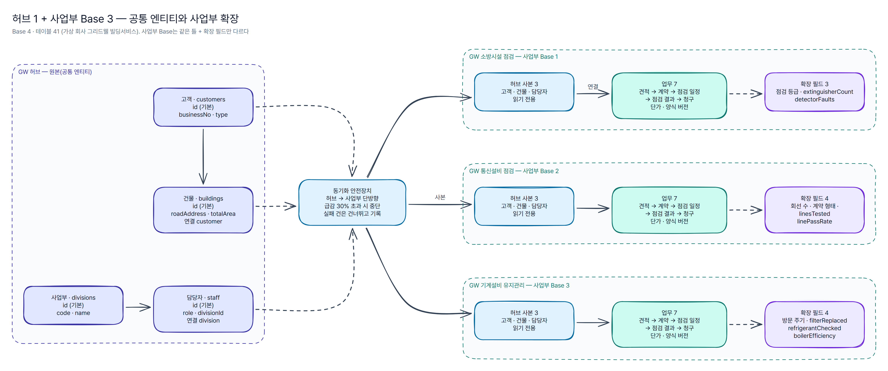
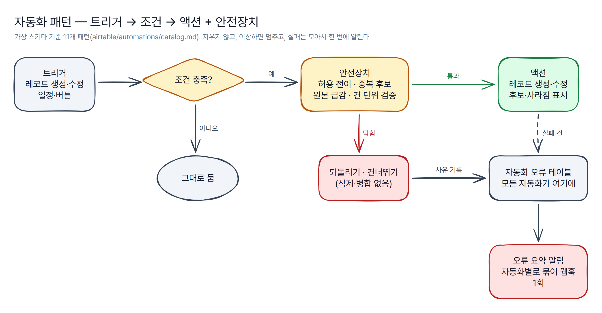

# airtable/ — 에어테이블 데이터 설계·자동화

가상 회사 "그리드웰 빌딩서비스"의 에어테이블 구조를 **YAML 스키마 하나**로 정의하고, 거기서 문서·도면·Base 생성 요청·시드·자동화 설정을 만든다. 실제 Airtable 계정 없이 전부 실행·검증된다(생성 스크립트는 기본 `--dry-run`).

*모든 Base·테이블·필드·데이터는 지어낸 것이며 실제 회사 구조와 무관하다.*



## 규모 (가상 스키마)

| Base | 테이블 | 내용 |
|---|---|---|
| 허브 1개 | 5 | 사업부·고객·건물·담당자(공통 엔티티 원본) + 자동화 오류 |
| 사업부 3개(소방·통신·기계) | 각 12 | 허브 사본 3 + 견적·계약·단가·양식 버전·점검 일정·점검 결과·청구 + 동기화 기록·자동화 오류 |
| 합계 | **41** | 필드 614 · 정방향 연결 43 · 계산 필드 37 — 표는 [`docs/schema.md`](../docs/schema.md) |

## 스키마 하나에서 나오는 것

```text
airtable/schema/gridwell.yaml ─┬─ docs/schema.md                       테이블·필드 표(자동 생성)
  (단일 출처)                   ├─ docs/diagrams/erd-*.yaml → .png       ERD 도면 사양
                                ├─ create-base.mjs --dry-run            Meta API 생성 요청
                                ├─ data/seed/csv/<base>/*.csv           CSV 가져오기용 시드
                                ├─ data/seed/ops/*.json                 운영 테이블 가상 데이터
                                ├─ automations/scripts/*.js             스크립트 설정 블록(상태 전이·동기화 규칙)
                                ├─ automations/catalog.md               자동화 패턴 표(필드 참조 검사)
                                └─ ../n8n/sync-safety.json              n8n Code 노드 규칙
data/schema/*.schema.json ──────── 견적 엔진 데이터 계약(6-1) ↔ 일관성 검사(lib/contract.js)
```

- `npm run airtable:build` — 위 산출물을 모두 다시 만든다. `npm run airtable:check` — 최신이 아니면 실패(CI).
- **견적 엔진 데이터 계약과의 일관성**: 계약 테이블(사업부·고객·건물·견적·계약·단가·양식 버전)은 YAML에 `contract:`로 연결하고, 테이블 이름·기본 필드·Base 종류·필드 집합·타입·선택지(enum)·JSON 필드·연결(`x-links` ↔ 연결 필드 `from`)을 하나씩 대조한다. 어긋나면 테스트가 실패한다. 계약에 없는 에어테이블 전용 필드(연결·룩업·운영 필드)는 견적 엔진의 에어테이블 어댑터가 읽을 때 버린다.
- 견적 엔진은 `AIRTABLE_HUB_BASE_ID`와 `AIRTABLE_BASE_ID_<사업부>`를 주면 이 구성(허브 + 사업부 Base)으로 읽고 쓴다(`quote-engine/src/core/store/airtable-multi.js`).

## 실제 Base에 만들기 (선택)

```bash
node airtable/create-base.mjs --dry-run                     # 요청만 출력(토큰 불필요)
# 빈 Base 4개를 만든 뒤 Base마다:
AIRTABLE_TOKEN=pat… node airtable/create-base.mjs --base hub --base-id app… --apply
```

1. PAT 권한은 `schema.bases:read`, `schema.bases:write`, 대상 Base만.
2. 테이블 → 일반 필드 → 연결 순서로 만들고, 이미 있는 것은 건너뛴다(다시 실행해도 안전).
3. 수식·룩업·롤업·개수 필드는 Meta API로 만들 수 없어 마지막에 "수동 추가" 목록을 출력한다.
4. 시드는 `data/seed/csv/<base>/`의 CSV를 번호 순서대로 가져온다(연결 대상이 먼저). 연결 열에는 대상의 기본 필드 값이 들어 있어 가져오기 때 이어진다.

스테이징 Base: 운영 Base를 복제한 뒤 `node airtable/clone-staging.mjs --base <키> --staging-base-id app… --apply`로 ID에 `stg_`를 붙이고 견적 엔진 가드용 매핑표를 만든다. `npm run airtable:clone-staging`은 가상 시드로 계획만 보여 준다([설계 원칙 6장](principles.md#6-스테이징-base와-id-매핑-가드)).

## 자동화



[`automations/catalog.md`](automations/catalog.md) — 트리거 → 조건 → 액션 패턴 11개. 그중 4개는 에어테이블 자동화의 "Run a script"에 붙여 넣는 스크립트다.

| 스크립트 | Base | 하는 일 | 안전장치 |
|---|---|---|---|
| [`status-guard.js`](automations/scripts/status-guard.js) | 사업부 | 허용된 상태 전이만 통과 | 아니면 되돌리고 사유 기록, 되돌림이 다시 트리거돼도 반복 없음 |
| [`duplicate-detect.js`](automations/scripts/duplicate-detect.js) | 허브 | 정규화 주소·사업자번호로 중복 후보 표시 | 병합·삭제 없음, '검토 완료'는 다시 띄우지 않음 |
| [`sync-safety.js`](automations/scripts/sync-safety.js) | 사업부 | 허브 → 사업부 사본 동기화 | 원본 30% 넘게 급감 시 중단, 건 단위 건너뛰기·기록, 사라진 건은 표시만 |
| [`error-alert.js`](automations/scripts/error-alert.js) | 모든 Base | 자동화 오류를 모아 웹훅 1회 | 발송 실패면 notified를 켜지 않아 다음에 다시 보냄 |

스크립트 안의 `BEGIN GENERATED` 구간(규칙·공용 판정 코드)은 빌드가 채운다. 손으로 고칠 곳은 그 밖이다.

### 하네스 테스트

[`automations/harness/airtable-harness.js`](automations/harness/airtable-harness.js)가 에어테이블 스크립팅 환경(`base`·`input`·`output`·`fetch`)을 흉내 낸다. 가짜 Base는 **스키마에서** 만든다. 그래서 스크립트가 없는 필드를 쓰거나, 단일 선택에 `{name}`이 아닌 문자열을 넣거나, 계산 필드에 쓰거나, 한 번에 50건 넘게 쓰거나, 읽어 오지 않은 필드를 읽으면 테스트가 실패한다. 스크립트 파일은 붙여 넣는 그대로 실행한다.

```bash
node --test airtable/test/automations.test.js
```

## 폴더

| 경로 | 내용 |
|---|---|
| [`schema/gridwell.yaml`](schema/gridwell.yaml) | 단일 출처 스키마 |
| [`principles.md`](principles.md) | 설계 원칙(공통 vs 전용, 이름 규칙, 연결·룩업, 상태값, 동기화, 스테이징 가드, 정제 순서) |
| `lib/` | 스키마 펼치기·검사, 계약 대조, 문서·ERD·CSV·Meta API·스테이징·n8n 생성 |
| `automations/` | 카탈로그, 스크립트 4개, 공용 판정 코드(`lib/`), 하네스 |
| `create-base.mjs` · `clone-staging.mjs` · `build.mjs` | 실행 진입점 |
| `test/` | node:test |
