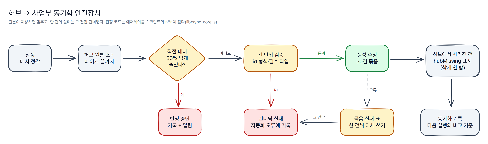

# 에어테이블 설계 원칙

가상 회사 "그리드웰 빌딩서비스" 스키마([`schema/gridwell.yaml`](schema/gridwell.yaml))가 따르는 원칙이다. 사업부마다 Excel로 흩어진 현장 데이터를 개발 조직 없이 에어테이블로 묶을 때, 나중에 사업부가 늘고 자동화가 많아져도 무너지지 않게 하려는 규칙들이다. 표·필드 목록은 [`docs/schema.md`](../docs/schema.md)(자동 생성).

## 1. 공통과 전용을 나눈다

| 층 | 어디에 | 무엇을 | 바꿀 때 |
|---|---|---|---|
| 공통 엔티티 | **허브 Base** | 사업부·고객·건물·담당자 | 허브에서만 고친다. 모든 사업부가 같은 고객·건물을 본다 |
| 사업부 업무 | **사업부 Base 틀**(사업부마다 1개) | 견적 → 계약 → 점검 일정 → 점검 결과 → 청구, 단가·양식 버전 | 틀을 고치면 모든 사업부에 같이 반영된다(사업부별로 따로 고치지 않는다) |
| 사업부 고유 값 | **확장 필드**(`extensions`) | 소방 점검 등급·소화기 수, 통신 회선 시험, 기계 필터·보일러 효율 | 그 사업부 Base에만 붙는다 |

- 새 사업부는 `divisions`에 한 줄, `extensions`에 고유 필드를 적으면 Base 생성 요청·문서·시드·도면이 함께 나온다. 견적 엔진에서 "설정 파일만 추가하면 사업부가 늘어나는" 구조([`docs/adding-a-division.md`](../docs/adding-a-division.md))를 데이터 쪽에서도 똑같이 지킨다.
- 공통 테이블에 사업부별 열을 계속 붙이면(소방용 열, 통신용 열 …) 모든 사업부가 서로의 빈 열을 보게 된다. 그래서 공통 틀은 좁게, 고유 값은 확장으로 뺀다.
- 사업부 Base의 업무 테이블은 모두 `divisionId`를 가진다. 여러 Base를 모아 볼 때(복제·통합 조회) 어느 사업부 데이터인지 레코드만 보고 알 수 있게.

## 2. 이름 규칙 — 누가 쓰는 필드인지 이름으로 구분한다

| 대상 | 규칙 | 예 | 이유 |
|---|---|---|---|
| 테이블 | 한국어 | 견적, 점검 일정 | 현업이 매일 보는 화면 |
| 코드가 읽고 쓰는 필드 | 영문 camelCase, **데이터 계약 키와 같게** | `quoteNo`, `customerId`, `statusConfirmed` | 이름을 바꾸면 견적 엔진·스크립트·n8n이 깨진다. 바꾸지 않는 이름으로 고정 |
| 사람이 보는 파생 필드 | 한국어 | 미수금, 점검 등급, 고객명 | 수식·룩업·롤업은 코드가 쓰지 않으니 자유롭게 바꿔도 된다 |
| 정방향 연결 | 대상 이름 영문 단수 | `customer`, `contract` | 자동화가 텍스트 ID로 채우는 필드 |
| 역방향 연결 | 원본 테이블 이름(에어테이블 기본값) | 계약 안의 "점검 일정" | 기본값과 같게 두면 Base를 새로 만들어도 이름이 같다 |
| 레코드 ID | 접두어 + 번호 | `cus_0001`, `ins_0001`, 스테이징은 `stg_cus_0001` | ID만 보고 테이블·환경을 안다 |
| 상태값 | 영문 코드 | `draft`·`sent`·`won`·`lost` | 화면 표시는 뷰에서 바꿔도 되지만 코드 비교는 안정적이어야 한다 |

스키마 검사(`npm test`)가 "코드가 쓰는 필드는 camelCase" 규칙을 강제한다.

## 3. 연결·룩업·텍스트 ID를 언제 쓰나

- **텍스트 ID가 원본이다.** 코드는 `customerId` 같은 텍스트 ID를 쓴다. 에어테이블 레코드 ID(`rec…`)는 Base를 복제하면 모두 바뀌고, 연결 필드는 다른 Base를 가리킬 수 없기 때문이다.
- **연결(link)은 같은 Base 안에서 사람이 따라가기 위해** 둔다. 자동화가 텍스트 ID로 연결을 채운다(카탈로그 A02). 그래서 연결 필드마다 `from: customerId`처럼 어느 텍스트 ID에서 오는지 적는다.
- **다른 Base의 데이터가 필요하면 연결하지 않고 사본을 받는다.** 사업부 Base의 고객·건물·담당자는 허브의 읽기 전용 사본이다(5장). 사본 안에서는 연결·룩업을 자유롭게 쓴다.
- **룩업은 보여 주기만.** 고객명·건물명처럼 화면에 필요한 값은 룩업으로 끌어오고, 복사해 두지 않는다(원본이 바뀌면 따라 바뀌게).
- **연결이 너무 많아지면 텍스트 참조로만 둔다.** 점검 결과의 `contractId`는 점검 일정을 거쳐 계약과 이어지므로 연결 없이 `ref: contracts`로만 표시했다. 연결을 다 걸면 계약 화면에 역방향 열이 끝없이 늘어난다.

## 4. 상태값은 규칙대로만 움직인다

- 상태 테이블(견적·계약·점검 일정·청구)마다 허용 전이를 스키마에 적는다(`statusFlow`). 표는 [`docs/schema.md`](../docs/schema.md#상태-전이).
- 에어테이블에는 "바뀌기 전 값"이 없다. 그래서 가드가 마지막으로 허용한 상태를 `statusConfirmed`에 따로 두고, 규칙에 없는 전이는 그 값으로 되돌린 뒤 `statusNote`에 사유를 남긴다([`status-guard.js`](automations/scripts/status-guard.js)).
- 종료 상태(`won`, `paid`, `expired` …)는 나가는 전이가 없다. 수주한 견적을 실수로 초안으로 돌리는 일, 입금된 청구가 다시 미수로 보이는 일을 막는다.
- 사람이 고치든 자동화가 고치든 같은 가드를 지난다. 미수 경과 자동화(A06)도 `issued → overdue`만 할 수 있다.

## 5. 허브 → 사업부 동기화

- **단방향.** 사본은 동기화만 쓴다. 사업부에서 고객 정보가 틀린 걸 발견하면 허브에서 고친다.
- **키는 `id`.** 에어테이블 레코드 ID가 아니라 데이터 계약 ID로 맞춘다.
- **이상하면 멈춘다.** 원본 건수가 직전 정상 실행보다 30% 넘게 줄면(필터·권한·실수로 지운 경우) 그 테이블은 반영하지 않고 기록·알림만 한다. 사본까지 비어 버리는 사고를 막는 장치다.
- **한 건의 실패가 전체를 멈추지 않는다.** 검증에 걸린 건은 건너뛰고, 묶음 쓰기가 실패하면 한 건씩 다시 써서 실패한 건만 남긴다.
- **지우지 않는다.** 허브에서 사라진 건은 `hubMissing`만 표시한다. 견적·계약이 그 고객을 가리키고 있을 수 있다.
- 같은 판정 코드([`lib/sync-core.js`](automations/lib/sync-core.js))를 에어테이블 스크립트와 n8n 워크플로가 함께 쓴다. 환경을 바꿔도 판정이 같다(테스트로 확인).

## 6. 스테이징 Base와 ID 매핑 가드

운영 데이터를 건드리지 않고 자동화·양식을 시험하려면 스테이징 Base가 필요하다. 문제는 복제한 Base에서도 우리 `id` 값이 운영과 같다는 점이다. 그대로 두면 스테이징에서 만든 데이터와 운영 데이터를 구분할 수 없고, 설정을 잘못한 날 운영 ID로 운영 Base에 쓰게 된다.

1. 운영 Base 4개를 에어테이블에서 "Duplicate base(레코드 포함)"로 복제한다.
2. [`clone-staging.mjs`](clone-staging.mjs)가 스테이징 Base의 `id`와 텍스트 ID 참조(`customerId` 등)에 `stg_`를 붙인다. `divisionId`는 코드가 정한 값이라 그대로 둔다.
3. 같은 스크립트가 **견적 엔진과 같은 형식의 매핑표**(`id-map.json`: `{tables: {customers: {cus_0001: "stg_cus_0001"}}, created: {}}`)를 만든다.
4. 견적 엔진의 스테이징 가드([`guard.js`](../quote-engine/src/core/store/guard.js))가 이 매핑표로 운영 ID를 스테이징 ID로 바꾸고, **매핑에 없는 ID 쓰기는 에러로 막는다.** 운영 대상 쓰기에 `stg_` ID가 섞여도 막는다.

테스트가 이 스크립트의 매핑표 값이 견적 엔진의 `toStaging()` 결과와 같고, 가드가 그 매핑표로 실제로 막는지 확인한다.

## 7. 데이터 정제 순서 — 주소 표준화 → 중복 → 연결

흩어진 Excel을 모을 때 순서를 바꾸면 일이 두 번이 된다.

1. **주소 표준화.** "서울 중구 예시로 12, 3층"과 "서울특별시 중구 예시로 12"는 같은 건물이다. 시도 약칭을 정식 명칭으로, 층·호·괄호를 지우고 공백을 없앤 키(`addressKey`)를 만든다. 규칙은 견적 엔진의 주소 정규화와 같다(테스트로 대조).
2. **중복 후보 표시.** 표준화한 주소(건물), 숫자만 남긴 사업자등록번호(고객)가 같으면 `dupCandidates`로 서로 잇는다. 자동 병합은 하지 않는다. 같은 주소의 다른 동, 같은 사업자의 다른 지점일 수 있어서 사람이 '검토 완료'를 누른다([`duplicate-detect.js`](automations/scripts/duplicate-detect.js)).
3. **연결.** 중복이 정리된 뒤에 견적·계약을 고객·건물에 잇는다. 먼저 이으면 중복 레코드 양쪽에 연결이 갈라져 합칠 때 다시 옮겨야 한다.

## 8. 만들 수 있는 것과 손으로 해야 하는 것

- 테이블·일반 필드·연결은 [`create-base.mjs`](create-base.mjs)가 Meta API로 만든다(이미 있으면 건너뜀).
- 수식·룩업·롤업·개수 필드는 Meta API로 만들 수 없다. 스키마에는 정의(수식 원문)를 그대로 적어 두고, `--dry-run` 출력과 [`docs/schema.md`](../docs/schema.md#수동으로-추가할-계산-필드)에 "수동 추가" 목록으로 남긴다. 계산 필드를 코드가 읽지 않게 설계한 이유이기도 하다.
- 자동화(트리거·조건)는 에어테이블 화면에서 만들고, 스크립트 본문만 이 저장소의 파일을 붙여 넣는다. 붙여 넣는 파일 안의 설정(상태 전이·동기화 규칙)은 스키마에서 자동으로 채워진다.
