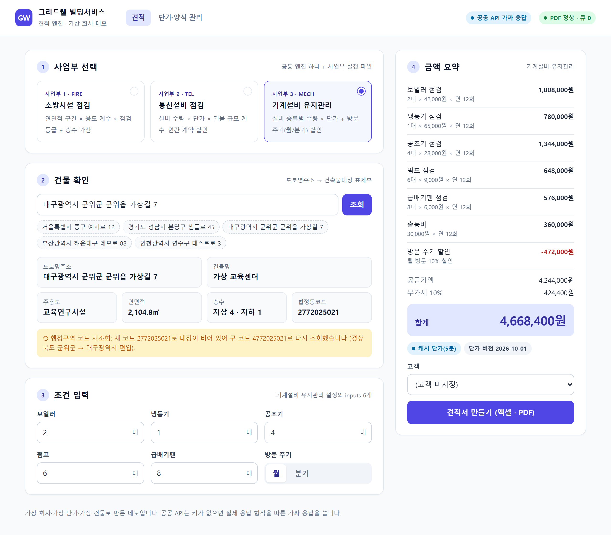

# 1인 운영 방식 — 개발 조직 없이 사내 도구를 돌리는 법

개발 조직이 없는 회사에서 데이터 구조·견적 도구·자동화를 혼자 만들고 운영할 때 지킨 원칙을 일반화해 적었다. 각 원칙이 이 저장소의 어느 코드·설정으로 재현돼 있는지 함께 적는다.

> 이 문서에 나오는 회사 수치(기능 배포 287건)는 **회사 운영 결과이며 이 저장소 데모와 무관하다.** 이 저장소의 커밋 수·테스트 수와 섞어 읽지 않는다.

| 원칙 | 한 줄 | 이 저장소에서 |
|---|---|---|
| 1. 작은 배포를 자주 | 한 번에 하나만 바꾸고, 바꾼 날 바로 내보낸다 | CI: 린트 → 스키마 파생물 최신 여부 → 테스트·커버리지 → Base 생성 dry-run → 견적 데모 |
| 2. 스테이징 → 운영 | 운영과 같은 구조의 복제본에서 먼저 돌린다 | `clone-staging.mjs` + 스테이징 ID 가드 |
| 3. 기록은 자동으로 | 무엇을·왜 바꿨는지 사람이 따로 정리하지 않게 | 스키마 YAML 하나에서 문서·도면 생성, 견적 기록에 단가·양식 버전 |
| 4. 현업이 고칠 곳은 화면으로 | 단가·양식처럼 자주 바뀌는 값은 코드 밖으로 | 관리자 화면(단가 수정, 양식 업로드 → 테스트 → 활성화) |
| 5. 장애는 알림 → 회고 → 장치로 | 조심하자는 다짐 대신 코드가 막게 | 오류 3줄 요약 알림, 자동화 오류 테이블, [장애 회고 4건](incidents.md) |

## 1. 작은 배포를 자주

- 혼자 운영하면 큰 배포 한 번이 가장 위험하다. 문제가 생겼을 때 무엇 때문인지 좁히기 어렵고, 되돌릴 범위도 크다. 그래서 **기능 하나 = 배포 하나**로 쪼갰다.
- 회사에서는 이 방식으로 2026-03\~07에 **기능 배포 287건**(2026-07-16 기준, 실측)을 냈다. *(회사 운영 결과)*
- 작게 자주 내려면 배포 전 확인이 자동이어야 한다. 이 저장소의 CI([`.github/workflows/ci.yml`](../.github/workflows/ci.yml))는 push마다 아래를 돈다.
  1. `npm run lint` — ESLint
  2. `npm run airtable:check` — 스키마 YAML에서 만든 문서·시드·스크립트 설정·n8n 워크플로가 최신인지(손으로 고친 파생물이 있으면 실패)
  3. `npm run coverage` — node:test 112개, 줄 커버리지 80% 미만이면 실패
  4. `airtable/create-base.mjs --dry-run` — 에어테이블 Base 생성 요청이 만들어지는지
  5. `npm run quote:demo` — 3개 사업부 견적과 안전장치 시연(LibreOffice가 설치되면 PDF까지)

## 2. 스테이징 → 운영

- 자동화·양식·단가 구조를 바꿀 때는 운영 Base를 복제한 **스테이징 Base**에서 먼저 돌린다.
- 복제본은 ID가 운영과 같아서, 설정을 잘못한 날 스테이징 작업이 운영 데이터를 덮을 수 있다. 그래서 스테이징 ID에는 `stg_`를 붙이고, 견적 엔진은 **매핑표에 없는 ID로 쓰기를 에러로 막는다.** 운영 쓰기에 `stg_` ID가 섞여도 막는다.
- 이 저장소에서: [`airtable/clone-staging.mjs`](../airtable/clone-staging.mjs)(ID 변환 + 매핑표), [`quote-engine/src/core/store/guard.js`](../quote-engine/src/core/store/guard.js)(가드), `STORE_TARGET=staging`으로 견적 엔진 실행. 자세한 절차: [에어테이블 설계 원칙 6장](../airtable/principles.md#6-스테이징-base와-id-매핑-가드)

## 3. 기록은 자동으로

- 1인 운영에서 문서는 늘 코드보다 늦다. 그래서 **문서를 손으로 쓰지 않아도 되는 구조**를 먼저 만들었다. 회사에서는 PR마다 무엇을·왜 바꿨는지 요약을 남기고 이를 자동으로 모아 변경 기록으로 썼다(이 저장소에는 그 도구를 넣지 않았다).
- 이 저장소에서 같은 생각을 적용한 곳:
  - **스키마 YAML 하나가 단일 출처.** [`airtable/schema/gridwell.yaml`](../airtable/schema/gridwell.yaml)에서 테이블 문서([`docs/schema.md`](schema.md))·ERD 도면·Base 생성 요청·CSV 시드·자동화 스크립트 설정·n8n 규칙이 만들어진다. 스키마를 고치면 문서가 같이 바뀌고, 안 바뀌면 CI가 실패한다.
  - **견적 기록에 근거를 남긴다.** 견적마다 단가 출처(`pricingSource`)·단가 버전·양식 버전이 저장된다. "이 견적은 왜 이 금액인가"를 나중에 다시 계산하지 않고 기록으로 답한다.
  - **자동화 오류는 한 테이블에.** 모든 자동화가 실패를 `자동화 오류` 테이블에 쓰고, 알림 스크립트가 묶어서 보낸다([`error-alert.js`](../airtable/automations/scripts/error-alert.js)).

## 4. 현업이 고칠 곳은 화면으로

- "단가 바꿔 주세요", "양식 문구 바꿔 주세요" 같은 요청이 개발자를 거치면 배포가 늘고, 반영 전까지 틀린 견적이 나간다([장애 회고 2·3](incidents.md#2-단가가-바뀔-때마다-배포해야-함)).
- 그래서 **자주 바뀌는 값은 화면에서 현업이 직접** 고치고, 코드는 그 값이 안전한지만 검사한다.
  - 단가: 관리자 화면에서 수정, 필수 키가 빠지면 저장 거부, 저장하면 캐시를 비움
  - 양식: 업로드하면 샘플 견적으로 자동 테스트 렌더, 통과한 것만 활성화, 문제가 생기면 되돌리기
- 에어테이블을 고른 이유도 같다. 테이블·뷰·필터는 현업이 직접 만들고 고칠 수 있다. 코드가 읽는 필드만 영문 이름으로 고정하고(이름을 바꾸면 견적 엔진·스크립트가 깨진다), 사람이 보는 수식·룩업 필드는 한국어로 자유롭게 두었다([설계 원칙 2장](../airtable/principles.md#2-이름-규칙--누가-쓰는-필드인지-이름으로-구분한다)).
- 문의가 반복되면 설명을 더하기보다 **화면 문구와 입력 검사로 막는다.** 예: 견적 화면은 행정구역 코드 재조회 사실을 안내하고, 관리자 화면은 테스트 렌더 실패 사유(어느 값 자리가 없는지)를 그대로 보여 준다.

| 견적 화면: 구 코드 재조회 안내 | 관리자 화면: 실패 사유와 활성화 차단 |
|---|---|
|  |  |

## 5. 장애는 알림 → 회고 → 장치로

1. **알림으로 먼저 안다.** 견적 엔진 서버 오류는 스택을 3줄(무엇이·어디서·조치)로 요약해 웹훅으로 보낸다. 같은 오류가 10분 안에 반복되면 한 번만 보낸다. 요약은 규칙 기반이 기본이고, 키가 있을 때만 LLM 요약을 시도한다([`core/notify.js`](../quote-engine/src/core/notify.js)). 에어테이블 자동화 오류는 `자동화 오류` 테이블에 모였다가 자동화별로 묶여 한 번에 알림으로 간다.
2. **회고는 짧게, 원인은 하나로.** 증상 → 원인 → 해결 → 재발 방지 장치 네 칸만 쓴다.
3. **사람이 조심하는 대신 코드가 막는다.** 장치마다 그 장애를 재현하는 테스트를 붙여, 나중에 코드를 고쳐도 같은 장애가 돌아오지 않게 한다.

장애 4건(PDF 동시 요청, 단가 하드코딩, 양식 변경, 행정구역 개편)의 회고와 해당 코드·테스트는 [`incidents.md`](incidents.md)에 있다.

## 운영 점검표

| 언제 | 무엇을 | 어디서 |
|---|---|---|
| 매일 | 오류 알림·자동화 오류 테이블 확인, 동기화 중단 기록 확인 | 웹훅 채널, `자동화 오류`·`동기화 기록` 테이블 |
| 배포 전 | CI 통과, 스테이징 Base에서 같은 흐름 실행 | GitHub Actions, `STORE_TARGET=staging` |
| 단가·양식 변경 요청 | 현업이 관리자 화면에서 직접 → 테스트 렌더 결과 확인 | `/admin.html` |
| 사업부 추가 | 사업부 설정 파일 + 단가 파일 추가, 스키마 YAML에 사업부 한 줄 | [`adding-a-division.md`](adding-a-division.md), [`gridwell.yaml`](../airtable/schema/gridwell.yaml) |
| 장애 뒤 | 회고 네 칸 작성 → 장치 + 재현 테스트 | [`incidents.md`](incidents.md) |
