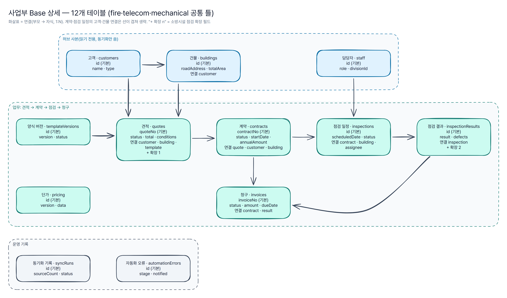

# 에어테이블 스키마

> **자동 생성 문서** — [`airtable/schema/gridwell.yaml`](../airtable/schema/gridwell.yaml)에서 `npm run airtable:build`로 만든다. 직접 고치지 않는다. CI가 `npm run airtable:check`로 최신 여부를 확인한다.
>
> 가상 회사 "그리드웰 빌딩서비스" 기준이며 실제 회사의 Base·테이블·필드와 무관하다. 시드 건수는 가상 데이터 기준.

## 한눈에 보기

| 항목 | 값 |
|---|---|
| Base | 4개 (허브 1 + 사업부 3: 소방시설 점검 · 통신설비 점검 · 기계설비 유지관리) |
| 테이블 | 41개 (허브 5 + 사업부 Base당 12) |
| 필드 | 614개 (데이터 계약 194 · 운영 248 · 허브 사본 51 · 연결 84 · 계산 37) |
| 연결 | 정방향 43개 (역방향은 에어테이블이 자동 생성) |
| 계산 필드 | 37개 (수식·룩업·롤업·개수 — Meta API로 만들 수 없어 수동 추가) |

| Base | 이름 | 테이블 | 필드 | 시드 레코드 |
|---|---|---|---|---|
| `hub` | GW 허브 | 5 | 63 | 73 |
| `fire` | GW 소방시설 점검 | 12 | 183 | 231 |
| `telecom` | GW 통신설비 점검 | 12 | 184 | 148 |
| `mechanical` | GW 기계설비 유지관리 | 12 | 184 | 101 |

## 필드 소유 구분

필드 이름만 보고 "누가 쓰는 필드인지" 알 수 있게 나눴다. 코드(견적 엔진·자동화 스크립트·n8n)가 읽고 쓰는 필드는 영문 camelCase로 고정하고, 사람이 화면에서 보는 파생 필드만 한국어로 짓는다. 한국어 필드는 이름을 바꿔도 코드가 깨지지 않는다.

| 소유 | 이름 규칙 | 누가 쓰나 | 예 |
|---|---|---|---|
| 데이터 계약 | 영문 camelCase = 데이터 계약 키 | 견적 엔진(`data/schema/*.schema.json`과 일치 검사) | `quoteNo` `total` |
| 운영 | 영문 camelCase | 자동화 스크립트·사람 | `businessNo` `statusConfirmed` |
| 허브 사본 | 허브와 같은 이름 | 동기화만 | 사업부 Base의 고객·건물·담당자 |
| 연결 | 정방향 영문(`customer`), 역방향 한국어(테이블 이름) | 자동화가 텍스트 ID로 채움 | `customer` ← `customerId` |
| 계산 | 한국어 | 에어테이블(사람이 봄) | 미수금, 점검 등급 |

## 허브 ↔ 사업부 동기화

- 방향: **허브 → 사업부 단방향**. 사업부 Base의 사본 테이블(고객·건물·담당자)은 읽기 전용이고, 고칠 일은 허브에서 고친다.
- 키: `id`(데이터 계약 ID). 에어테이블 레코드 ID(`rec…`)는 Base마다 달라 키로 쓰지 않는다.
- 안전장치: 원본 건수가 직전 정상 실행 대비 **30% 넘게 줄면 반영 중단**, 검증 실패·쓰기 실패는 **건 단위로 건너뛰고 기록**, 허브에서 사라진 건은 지우지 않고 `hubMissing` 표시, 쓰기 묶음 50건.
- 구현: 에어테이블 스크립트 [`sync-safety.js`](../airtable/automations/scripts/sync-safety.js) 또는 n8n [`sync-safety.json`](../n8n/sync-safety.json). 판정 코드는 같다.

| 사본 테이블 | 원본(허브) | 동기화 필드 | 필수 | ID 형식 |
|---|---|---|---|---|
| 고객 | 고객 | `id` `name` `type` `region` | `id` `name` `type` | `^(stg_)?cus_[0-9a-z]+$` |
| 건물 | 건물 | `id` `customerId` `roadAddress` `name` `mainPurpose` `totalArea` `groundFloors` `undergroundFloors` | `id` `roadAddress` `name` `mainPurpose` `totalArea` `groundFloors` `undergroundFloors` | `^(stg_)?bld_[0-9a-z]+$` |
| 담당자 | 담당자 | `id` `name` `divisionId` `role` `active` | `id` `name` `role` `active` | `^(stg_)?stf_[0-9a-z]+$` |

## 상태 전이

상태 전이 가드 스크립트([`status-guard.js`](../airtable/automations/scripts/status-guard.js))가 아래 표에 없는 전이를 되돌리고 사유를 남긴다.

| 테이블 | 상태 | 갈 수 있는 상태 |
|---|---|---|
| 견적 | `draft` | `sent` · `lost` |
| 견적 | `sent` | `won` · `lost` · `draft` |
| 견적 | `won` | — (종료) |
| 견적 | `lost` | `draft` |
| 계약 | `pending` | `active` · `terminated` |
| 계약 | `active` | `expired` · `terminated` |
| 계약 | `expired` | — (종료) |
| 계약 | `terminated` | — (종료) |
| 점검 일정 | `scheduled` | `done` · `missed` · `cancelled` |
| 점검 일정 | `missed` | `scheduled` · `cancelled` |
| 점검 일정 | `done` | — (종료) |
| 점검 일정 | `cancelled` | — (종료) |
| 청구 | `issued` | `paid` · `overdue` · `void` |
| 청구 | `overdue` | `paid` · `void` |
| 청구 | `paid` | — (종료) |
| 청구 | `void` | — (종료) |

## 사업부 확장 필드

공통 틀(견적·점검 결과 등)은 사업부마다 같고, 사업부 고유 값만 덧붙인다. 새 사업부는 `divisions`와 `extensions`에 항목을 추가하면 Base 생성 요청·문서·시드가 함께 나온다.

| 사업부 | 테이블 | 필드 | 타입 | 설명 |
|---|---|---|---|---|
| 소방시설 점검 | 견적 | 점검 등급 | formula: `REGEX_EXTRACT({conditions}, '"grade":"([^"]*)"')` |  |
| 소방시설 점검 | 점검 결과 | extinguisherCount | number(정수) | 점검한 소화기 수 |
| 소방시설 점검 | 점검 결과 | detectorFaults | number(정수) | 감지기 불량 수 |
| 통신설비 점검 | 견적 | 회선 수 | formula: `VALUE(REGEX_EXTRACT({conditions}, '"lines":([0-9]+)'))` |  |
| 통신설비 점검 | 견적 | 계약 형태 | formula: `REGEX_EXTRACT({conditions}, '"contract":"([^"]*)"')` |  |
| 통신설비 점검 | 점검 결과 | linesTested | number(정수) | 시험한 회선 수 |
| 통신설비 점검 | 점검 결과 | linePassRate | percent | 회선 시험 통과율 |
| 기계설비 유지관리 | 견적 | 방문 주기 | formula: `REGEX_EXTRACT({conditions}, '"cycle":"([^"]*)"')` |  |
| 기계설비 유지관리 | 점검 결과 | filterReplaced | checkbox | 필터 교체 |
| 기계설비 유지관리 | 점검 결과 | refrigerantChecked | checkbox | 냉매 점검 |
| 기계설비 유지관리 | 점검 결과 | boilerEfficiency | percent | 보일러 효율 측정값 |

## 수동으로 추가할 계산 필드

Meta API는 수식·룩업·롤업·개수 필드를 만들지 못한다. `create-base.mjs`가 테이블·일반 필드·연결을 만든 뒤, 아래 필드는 에어테이블 화면에서 추가한다(`--dry-run` 출력 끝에도 같은 목록이 나온다).

| Base | 테이블 | 필드 | 정의 |
|---|---|---|---|
| GW 허브 | 사업부 | 담당자 수 | count: 담당자 |
| GW 허브 | 고객 | 건물 수 | count: 건물 |
| GW 허브 | 건물 | 고객명 | lookup: customer.name |
| 사업부 Base 공통 | 견적 | 고객명 | lookup: customer.name |
| 사업부 Base 공통 | 견적 | 건물명 | lookup: building.name |
| GW 소방시설 점검 | 견적 | 점검 등급 | formula: `REGEX_EXTRACT({conditions}, '"grade":"([^"]*)"')` |
| 사업부 Base 공통 | 계약 | 점검 횟수 | count: 점검 일정 |
| 사업부 Base 공통 | 계약 | 청구 합계 | rollup: 청구.amount → `SUM(values)` |
| 사업부 Base 공통 | 계약 | 입금 합계 | rollup: 청구.paidAmount → `SUM(values)` |
| 사업부 Base 공통 | 계약 | 미수금 | formula: `{청구 합계} - {입금 합계}` |
| 사업부 Base 공통 | 점검 일정 | 건물명 | lookup: building.name |
| 사업부 Base 공통 | 점검 일정 | D-day | formula: `IF({status} = 'scheduled', DATETIME_DIFF({scheduledDate}, TODAY(), 'days'), BLANK())` |
| 사업부 Base 공통 | 청구 | 미수액 | formula: `{amount} - {paidAmount}` |
| 사업부 Base 공통 | 청구 | 경과일 | formula: `IF(OR({status} = 'issued', {status} = 'overdue'), DATETIME_DIFF(TODAY(), {dueDate}, 'days'), BLANK())` |
| GW 통신설비 점검 | 견적 | 회선 수 | formula: `VALUE(REGEX_EXTRACT({conditions}, '"lines":([0-9]+)'))` |
| GW 통신설비 점검 | 견적 | 계약 형태 | formula: `REGEX_EXTRACT({conditions}, '"contract":"([^"]*)"')` |
| GW 기계설비 유지관리 | 견적 | 방문 주기 | formula: `REGEX_EXTRACT({conditions}, '"cycle":"([^"]*)"')` |

## Base별 테이블

### GW 허브 (`hub`)

모든 사업부가 함께 쓰는 공통 엔티티(사업부·고객·건물·담당자)의 원본. 사업부 Base는 이 Base의 사본을 받는다.

#### 사업부 (`divisions`) — 데이터 계약 `divisions`

견적 엔진 레지스트리(divisions/*/config.js)의 사본. 코드가 원본이다.

| 필드 | 타입 | 소유 | 설명 |
|---|---|---|---|
| **id** (기본) | singleLineText | 데이터 계약 | 사업부 ID = divisions/ 폴더 이름 (예: fire) |
| code | singleLineText | 데이터 계약 | 견적번호에 들어가는 코드 (예: FIRE) |
| name | singleLineText | 데이터 계약 | 표시 이름 (예: 소방시설 점검) |
| order | number(정수) | 데이터 계약 | 확산 순서 (1번째, 2번째, 3번째 사업부) |
| description | multilineText | 데이터 계약 |  |
| createdAt | dateTime | 데이터 계약 |  |
| updatedAt | dateTime | 데이터 계약 |  |
| 담당자 수 | count: 담당자 | 계산 |  |
| 담당자 | link → 담당자 · 역방향 | 연결 | 담당자.division의 역방향(자동) |

#### 고객 (`customers`) — 데이터 계약 `customers` · ID `cus_…`

견적·계약의 상대방. 사업부와 무관하게 한 번만 등록한다.

| 필드 | 타입 | 소유 | 설명 |
|---|---|---|---|
| **id** (기본) | singleLineText | 데이터 계약 |  |
| name | singleLineText | 데이터 계약 | 고객명(가상) |
| type | singleSelect: 법인 · 관리단 · 관리사무소 · 개인사업자 | 데이터 계약 |  |
| region | singleSelect: 서울특별시 · 부산광역시 · 대구광역시 · 인천광역시 · 대전광역시 · 경기도 | 데이터 계약 | 시도 |
| contactEmail | email | 데이터 계약 | example.com 도메인만 사용 |
| note | multilineText | 데이터 계약 |  |
| createdAt | dateTime | 데이터 계약 | ISO 8601 |
| updatedAt | dateTime | 데이터 계약 |  |
| businessNo | singleLineText | 운영 | 사업자등록번호(가상, 000-으로 시작). 중복 감지 키 |
| dupCandidates | link → 고객 | 연결 | 중복 후보(자동 표시만 |
| dupStatus | singleSelect: 후보 없음 · 후보 있음 · 검토 완료 | 운영 |  |
| dupCheckedAt | dateTime | 운영 |  |
| 건물 수 | count: 건물 | 계산 |  |
| 건물 | link → 건물 · 역방향 | 연결 | 건물.customer의 역방향(자동) |

#### 건물 (`buildings`) — 데이터 계약 `buildings` · ID `bld_…`

주소 1건 = 건물 1건. 건축물대장 표제부 요약. 견적 엔진이 새 주소를 조회하면 여기에 추가한다.

| 필드 | 타입 | 소유 | 설명 |
|---|---|---|---|
| **id** (기본) | singleLineText | 데이터 계약 |  |
| customerId | singleLineText | 데이터 계약 | → customers.id |
| roadAddress | singleLineText | 데이터 계약 | 도로명주소(건물 단위) |
| jibunAddress | singleLineText | 데이터 계약 |  |
| admCd | singleLineText | 데이터 계약 | 법정동코드 10자리(시군구 5 + 법정동 5) |
| registerKey | singleLineText | 데이터 계약 | 대장 조회 키 sigunguCd-bjdongCd-platGbCd-bun-ji |
| adminCodeFallback | multilineText(JSON) | 데이터 계약 | 구 행정코드로 재조회한 경우 {from, to, reason} |
| name | singleLineText | 데이터 계약 |  |
| mainPurpose | singleLineText | 데이터 계약 | 주용도(대장 mainPurpsCdNm) |
| totalArea | number | 데이터 계약 | 연면적 ㎡ |
| groundFloors | number(정수) | 데이터 계약 |  |
| undergroundFloors | number(정수) | 데이터 계약 |  |
| dongCount | number(정수) | 데이터 계약 |  |
| approvalDate | singleLineText | 데이터 계약 | 사용승인일 YYYYMMDD |
| source | singleSelect: fixture · live · seed | 데이터 계약 |  |
| createdAt | dateTime | 데이터 계약 |  |
| updatedAt | dateTime | 데이터 계약 |  |
| customer | link → 고객 (← `customerId`) | 연결 |  |
| addressKey | singleLineText | 운영 | 정규화 주소 키(공백 제거). 중복 감지 스크립트가 채운다 |
| dupCandidates | link → 건물 | 연결 | 중복 후보(자동 표시만 |
| dupStatus | singleSelect: 후보 없음 · 후보 있음 · 검토 완료 | 운영 |  |
| dupCheckedAt | dateTime | 운영 |  |
| 고객명 | lookup: customer.name | 계산 |  |

#### 담당자 (`staff`) — ID `stf_…`

점검원·영업·관리자. 이름은 역할 표기만 쓴 가상 값.

| 필드 | 타입 | 소유 | 설명 |
|---|---|---|---|
| **id** (기본) | singleLineText | 운영 | stf_ + 4자리 |
| name | singleLineText | 운영 |  |
| divisionId | singleLineText | 운영 | → 사업부.id (관리자는 비움) |
| role | singleSelect: 점검원 · 영업 · 관리자 | 운영 |  |
| email | email | 운영 | example.com만 |
| active | checkbox | 운영 |  |
| createdAt | dateTime | 운영 |  |
| division | link → 사업부 (← `divisionId`) | 연결 |  |

#### 자동화 오류 (`automationErrors`) — 모든 Base 공통 · ID `err_…`

자동화·동기화에서 난 실패를 모아 두는 곳. 오류 알림 스크립트가 notified=false인 건을 묶어 웹훅으로 보낸다.

| 필드 | 타입 | 소유 | 설명 |
|---|---|---|---|
| **id** (기본) | singleLineText | 운영 | err_ + 시각·난수 |
| automation | singleLineText | 운영 | 자동화 이름(statusGuard, duplicateDetect, syncSafety, n8n:syncSafety …) |
| stage | singleSelect: skipped · failed · aborted · error | 운영 | skipped=검증 실패로 건너뜀, failed=반영 실패, aborted=반영 중단, error=스크립트 예외 |
| tableName | singleLineText | 운영 | 대상 테이블 |
| recordId | singleLineText | 운영 | 대상 레코드의 id(계약 ID). 없으면 비움 |
| message | multilineText | 운영 |  |
| occurredAt | dateTime | 운영 |  |
| notified | checkbox | 운영 | 알림 발송 여부 |
| notifiedAt | dateTime | 운영 |  |

### 사업부 Base 틀 (`fire` · `telecom` · `mechanical`)

사업부 1개의 업무 데이터(견적→계약→점검→청구). 공통 틀은 같고 사업부 고유 값은 extensions로 붙인다. 아래는 공통 틀이고(확장 필드 제외), 연결 대상은 같은 Base 안의 테이블이다.

#### 고객 (`customers`) — 허브 `customers`의 사본 · ID `cus_…`

허브 고객의 읽기 전용 사본. 동기화만 쓴다.

| 필드 | 타입 | 소유 | 설명 |
|---|---|---|---|
| **id** (기본) | singleLineText | 허브 사본 |  |
| name | singleLineText | 허브 사본 | 고객명(가상) |
| type | singleSelect: 법인 · 관리단 · 관리사무소 · 개인사업자 | 허브 사본 |  |
| region | singleSelect: 서울특별시 · 부산광역시 · 대구광역시 · 인천광역시 · 대전광역시 · 경기도 | 허브 사본 | 시도 |
| syncedAt | dateTime | 운영 | 마지막 반영 시각 |
| syncHash | singleLineText | 운영 | 반영한 원본 값의 지문(변경 감지) |
| hubMissing | checkbox | 운영 | 허브에서 사라짐(지우지 않고 표시만) |
| 건물 | link → 건물 · 역방향 | 연결 | 건물.customer의 역방향(자동) |
| 견적 | link → 견적 · 역방향 | 연결 | 견적.customer의 역방향(자동) |
| 계약 | link → 계약 · 역방향 | 연결 | 계약.customer의 역방향(자동) |

#### 건물 (`buildings`) — 허브 `buildings`의 사본 · ID `bld_…`

허브 건물의 읽기 전용 사본. 동기화만 쓴다.

| 필드 | 타입 | 소유 | 설명 |
|---|---|---|---|
| **id** (기본) | singleLineText | 허브 사본 |  |
| customerId | singleLineText | 허브 사본 | → customers.id |
| roadAddress | singleLineText | 허브 사본 | 도로명주소(건물 단위) |
| name | singleLineText | 허브 사본 |  |
| mainPurpose | singleLineText | 허브 사본 | 주용도(대장 mainPurpsCdNm) |
| totalArea | number | 허브 사본 | 연면적 ㎡ |
| groundFloors | number(정수) | 허브 사본 |  |
| undergroundFloors | number(정수) | 허브 사본 |  |
| syncedAt | dateTime | 운영 | 마지막 반영 시각 |
| syncHash | singleLineText | 운영 | 반영한 원본 값의 지문(변경 감지) |
| hubMissing | checkbox | 운영 | 허브에서 사라짐(지우지 않고 표시만) |
| customer | link → 고객 (← `customerId`) | 연결 |  |
| 견적 | link → 견적 · 역방향 | 연결 | 견적.building의 역방향(자동) |
| 계약 | link → 계약 · 역방향 | 연결 | 계약.building의 역방향(자동) |
| 점검 일정 | link → 점검 일정 · 역방향 | 연결 | 점검 일정.building의 역방향(자동) |

#### 담당자 (`staff`) — 허브 `staff`의 사본 · ID `stf_…`

허브 담당자의 사본(이 사업부 담당자만 쓰지만 전체를 받는다).

| 필드 | 타입 | 소유 | 설명 |
|---|---|---|---|
| **id** (기본) | singleLineText | 허브 사본 | stf_ + 4자리 |
| name | singleLineText | 허브 사본 |  |
| divisionId | singleLineText | 허브 사본 | → 사업부.id (관리자는 비움) |
| role | singleSelect: 점검원 · 영업 · 관리자 | 허브 사본 |  |
| active | checkbox | 허브 사본 |  |
| syncedAt | dateTime | 운영 | 마지막 반영 시각 |
| syncHash | singleLineText | 운영 | 반영한 원본 값의 지문(변경 감지) |
| hubMissing | checkbox | 운영 | 허브에서 사라짐(지우지 않고 표시만) |
| 점검 일정 | link → 점검 일정 · 역방향 | 연결 | 점검 일정.assignee의 역방향(자동) |

#### 견적 (`quotes`) — 데이터 계약 `quotes` · ID `quo_…`

견적 엔진이 만드는 견적. 공통 필드 + 사업부별 conditions·items(JSON).

| 필드 | 타입 | 소유 | 설명 |
|---|---|---|---|
| **quoteNo** (기본) | singleLineText | 데이터 계약 | GW-{사업부코드}-{YYYYMMDD}-{일련번호} |
| id | singleLineText | 데이터 계약 |  |
| divisionId | singleLineText | 데이터 계약 | → divisions.id |
| customerId | singleLineText | 데이터 계약 | → customers.id |
| buildingId | singleLineText | 데이터 계약 | → buildings.id |
| conditions | multilineText(JSON) | 데이터 계약 | 사업부 config.inputs 값 (예: fire {grade}, mechanical {boilers, cycle…}) |
| items | multilineText(JSON) | 데이터 계약 | [{code, name, basis, amount}] 산출 항목 |
| subtotal | currency(원) | 데이터 계약 | 공급가액(원) |
| vat | currency(원) | 데이터 계약 |  |
| total | currency(원) | 데이터 계약 | 합계(원, VAT 포함) |
| pricingSource | singleSelect: store · cache · fallback | 데이터 계약 | 계산에 쓴 단가의 출처 |
| pricingVersion | singleLineText | 데이터 계약 |  |
| templateVersionId | singleLineText | 데이터 계약 | → templateVersions.id (생성 스크립트로 만든 과거 견적은 null) |
| templateVersion | number(정수) | 데이터 계약 |  |
| files | multilineText(JSON) | 데이터 계약 | {xlsx, pdf} 저장소 기준 상대 경로 |
| pdfStatus | singleSelect: ok · skipped · circuit-open · failed | 데이터 계약 |  |
| status | singleSelect: draft · sent · won · lost | 데이터 계약 |  |
| createdAt | dateTime | 데이터 계약 |  |
| updatedAt | dateTime | 데이터 계약 |  |
| customer | link → 고객 (← `customerId`) | 연결 |  |
| building | link → 건물 (← `buildingId`) | 연결 |  |
| template | link → 양식 버전 (← `templateVersionId`) | 연결 |  |
| 고객명 | lookup: customer.name | 계산 |  |
| 건물명 | lookup: building.name | 계산 |  |
| statusConfirmed | singleLineText | 운영 | 상태 전이 가드가 마지막으로 허용한 상태(되돌릴 기준) |
| statusNote | multilineText | 운영 | 상태 전이 기록(허용·거부 사유) |
| 계약 | link → 계약 · 역방향 | 연결 | 계약.quote의 역방향(자동) |

#### 계약 (`contracts`) — 데이터 계약 `contracts` · ID `con_…`

수주(won) 견적에서 만든 계약. 점검 일정·청구의 기준.

| 필드 | 타입 | 소유 | 설명 |
|---|---|---|---|
| **contractNo** (기본) | singleLineText | 데이터 계약 | GW-C-{YYYY}-{일련번호} |
| id | singleLineText | 데이터 계약 |  |
| quoteId | singleLineText | 데이터 계약 | → quotes.id |
| customerId | singleLineText | 데이터 계약 | → customers.id |
| buildingId | singleLineText | 데이터 계약 | → buildings.id |
| divisionId | singleLineText | 데이터 계약 | → divisions.id |
| startDate | date | 데이터 계약 | YYYY-MM-DD |
| endDate | date | 데이터 계약 |  |
| annualAmount | currency(원) | 데이터 계약 | 연간 계약 금액(원, VAT 포함) |
| status | singleSelect: pending · active · expired · terminated | 데이터 계약 |  |
| createdAt | dateTime | 데이터 계약 |  |
| updatedAt | dateTime | 데이터 계약 |  |
| visitsPerYear | number(정수) | 운영 | 연간 방문 횟수. 점검 일정 생성 자동화가 읽는다(소방 2·통신 4·기계 월 12/분기 4) |
| quote | link → 견적 (← `quoteId`) | 연결 |  |
| customer | link → 고객 (← `customerId`) | 연결 |  |
| building | link → 건물 (← `buildingId`) | 연결 |  |
| 점검 횟수 | count: 점검 일정 | 계산 |  |
| 청구 합계 | rollup: 청구.amount → `SUM(values)` | 계산 |  |
| 입금 합계 | rollup: 청구.paidAmount → `SUM(values)` | 계산 |  |
| 미수금 | formula: `{청구 합계} - {입금 합계}` | 계산 |  |
| statusConfirmed | singleLineText | 운영 | 상태 전이 가드가 마지막으로 허용한 상태(되돌릴 기준) |
| statusNote | multilineText | 운영 | 상태 전이 기록(허용·거부 사유) |
| 점검 일정 | link → 점검 일정 · 역방향 | 연결 | 점검 일정.contract의 역방향(자동) |
| 청구 | link → 청구 · 역방향 | 연결 | 청구.contract의 역방향(자동) |

#### 단가 (`pricing`) — 데이터 계약 `pricing` · ID `prc_…`

사업부 단가표 1건. 현업이 코드 수정 없이 고친다(견적 엔진 5분 캐시).

| 필드 | 타입 | 소유 | 설명 |
|---|---|---|---|
| **id** (기본) | singleLineText | 데이터 계약 |  |
| divisionId | singleLineText | 데이터 계약 | → divisions.id |
| version | singleLineText | 데이터 계약 | 단가표 버전(날짜 문자열 권장) |
| source | singleSelect: 가상 | 데이터 계약 | 모든 단가는 지어낸 값 |
| data | multilineText(JSON) | 데이터 계약 |  |
| updatedBy | singleLineText | 데이터 계약 |  |
| createdAt | dateTime | 데이터 계약 |  |
| updatedAt | dateTime | 데이터 계약 |  |

#### 양식 버전 (`templateVersions`) — 데이터 계약 `templateVersions` · ID `tpl_…`

엑셀 견적 양식 버전(업로드 → 테스트 → 활성화). 사업부별 active는 1개.

| 필드 | 타입 | 소유 | 설명 |
|---|---|---|---|
| **id** (기본) | singleLineText | 데이터 계약 |  |
| divisionId | singleLineText | 데이터 계약 | → divisions.id |
| version | number(정수) | 데이터 계약 |  |
| status | singleSelect: uploaded · tested · failed · active · inactive | 데이터 계약 |  |
| sha256 | singleLineText | 데이터 계약 |  |
| size | number(정수) | 데이터 계약 |  |
| filePath | singleLineText | 데이터 계약 | 저장소 폴더 기준 상대 경로 |
| note | multilineText | 데이터 계약 |  |
| uploadedBy | singleLineText | 데이터 계약 |  |
| uploadedAt | dateTime | 데이터 계약 |  |
| testReport | multilineText(JSON) | 데이터 계약 | {ok, errors[], warnings[], testedAt} |
| activatedAt | dateTime | 데이터 계약 |  |
| deactivatedAt | dateTime | 데이터 계약 |  |
| createdAt | dateTime | 데이터 계약 |  |
| updatedAt | dateTime | 데이터 계약 |  |
| 견적 | link → 견적 · 역방향 | 연결 | 견적.template의 역방향(자동) |

#### 점검 일정 (`inspections`) — ID `ins_…`

계약에서 만든 방문 일정. 계약 활성화 시 연간 방문 횟수만큼 생성한다.

| 필드 | 타입 | 소유 | 설명 |
|---|---|---|---|
| **id** (기본) | singleLineText | 운영 | ins_ + 4자리 |
| divisionId | singleLineText | 운영 |  |
| contractId | singleLineText | 운영 |  |
| buildingId | singleLineText | 운영 |  |
| assigneeId | singleLineText | 운영 | → 담당자.id |
| scheduledDate | date | 운영 |  |
| visitNo | number(정수) | 운영 | 계약 안에서 몇 번째 방문인지 |
| status | singleSelect: scheduled · done · missed · cancelled | 운영 |  |
| createdAt | dateTime | 운영 |  |
| contract | link → 계약 (← `contractId`) | 연결 |  |
| building | link → 건물 (← `buildingId`) | 연결 |  |
| assignee | link → 담당자 (← `assigneeId`) | 연결 |  |
| 건물명 | lookup: building.name | 계산 |  |
| D-day | formula: `IF({status} = 'scheduled', DATETIME_DIFF({scheduledDate}, TODAY(), 'days'), BLANK())` | 계산 |  |
| statusConfirmed | singleLineText | 운영 | 상태 전이 가드가 마지막으로 허용한 상태(되돌릴 기준) |
| statusNote | multilineText | 운영 | 상태 전이 기록(허용·거부 사유) |
| 점검 결과 | link → 점검 결과 · 역방향 | 연결 | 점검 결과.inspection의 역방향(자동) |

#### 점검 결과 (`inspectionResults`) — ID `res_…`

방문 1회의 결과. 공통 필드 + 사업부 확장 필드(extensions).

| 필드 | 타입 | 소유 | 설명 |
|---|---|---|---|
| **id** (기본) | singleLineText | 운영 | res_ + 4자리 |
| divisionId | singleLineText | 운영 |  |
| inspectionId | singleLineText | 운영 |  |
| contractId | singleLineText | 운영 | → 계약.id (연결 없이 텍스트로만 참조: 점검 일정을 거쳐 이어진다) |
| inspectedAt | date | 운영 |  |
| result | singleSelect: pass · actionRequired · fail | 운영 | 적합 · 조치 필요 · 부적합 |
| defects | number(정수) | 운영 | 지적 사항 수 |
| findings | multilineText | 운영 |  |
| createdAt | dateTime | 운영 |  |
| inspection | link → 점검 일정 (← `inspectionId`) | 연결 |  |
| 청구 | link → 청구 · 역방향 | 연결 | 청구.result의 역방향(자동) |

#### 청구 (`invoices`) — ID `inv_…`

점검 결과 1건 = 청구 1건(연간 금액 ÷ 방문 횟수). 입금되면 paid.

| 필드 | 타입 | 소유 | 설명 |
|---|---|---|---|
| **invoiceNo** (기본) | singleLineText | 운영 | GW-INV-{사업부코드}-{YYYY}-{일련번호} |
| id | singleLineText | 운영 | inv_ + 4자리 |
| divisionId | singleLineText | 운영 |  |
| contractId | singleLineText | 운영 |  |
| resultId | singleLineText | 운영 | → 점검 결과.id |
| amount | currency(원) | 운영 |  |
| issuedAt | date | 운영 |  |
| dueDate | date | 운영 |  |
| paidAt | date | 운영 |  |
| paidAmount | currency(원) | 운영 |  |
| status | singleSelect: issued · paid · overdue · void | 운영 |  |
| createdAt | dateTime | 운영 |  |
| contract | link → 계약 (← `contractId`) | 연결 |  |
| result | link → 점검 결과 (← `resultId`) | 연결 |  |
| 미수액 | formula: `{amount} - {paidAmount}` | 계산 |  |
| 경과일 | formula: `IF(OR({status} = 'issued', {status} = 'overdue'), DATETIME_DIFF(TODAY(), {dueDate}, 'days'), BLANK())` | 계산 |  |
| statusConfirmed | singleLineText | 운영 | 상태 전이 가드가 마지막으로 허용한 상태(되돌릴 기준) |
| statusNote | multilineText | 운영 | 상태 전이 기록(허용·거부 사유) |

#### 동기화 기록 (`syncRuns`) — ID `syn_…`

허브 → 사업부 동기화 1회 × 테이블 1개 = 1행. 다음 실행이 직전 원본 건수와 비교하는 기준.

| 필드 | 타입 | 소유 | 설명 |
|---|---|---|---|
| **id** (기본) | singleLineText | 운영 | syn_ + 시각·난수 |
| divisionId | singleLineText | 운영 |  |
| runner | singleSelect: airtable-script · n8n | 운영 |  |
| tableKey | singleLineText | 운영 | 동기화한 테이블(customers·buildings·staff) |
| startedAt | dateTime | 운영 |  |
| finishedAt | dateTime | 운영 |  |
| sourceCount | number(정수) | 운영 | 이번 원본 건수 |
| previousCount | number(정수) | 운영 | 직전 정상 실행의 원본 건수 |
| created | number(정수) | 운영 |  |
| updated | number(정수) | 운영 |  |
| unchanged | number(정수) | 운영 |  |
| skipped | number(정수) | 운영 | 검증 실패로 건너뜀 |
| failed | number(정수) | 운영 | 반영 실패 |
| missing | number(정수) | 운영 | 허브에서 사라져 hubMissing 표시 |
| status | singleSelect: ok · partial · aborted | 운영 |  |
| note | multilineText | 운영 |  |

#### 자동화 오류 (`automationErrors`) — 모든 Base 공통 · ID `err_…`

자동화·동기화에서 난 실패를 모아 두는 곳. 오류 알림 스크립트가 notified=false인 건을 묶어 웹훅으로 보낸다.

| 필드 | 타입 | 소유 | 설명 |
|---|---|---|---|
| **id** (기본) | singleLineText | 운영 | err_ + 시각·난수 |
| automation | singleLineText | 운영 | 자동화 이름(statusGuard, duplicateDetect, syncSafety, n8n:syncSafety …) |
| stage | singleSelect: skipped · failed · aborted · error | 운영 | skipped=검증 실패로 건너뜀, failed=반영 실패, aborted=반영 중단, error=스크립트 예외 |
| tableName | singleLineText | 운영 | 대상 테이블 |
| recordId | singleLineText | 운영 | 대상 레코드의 id(계약 ID). 없으면 비움 |
| message | multilineText | 운영 |  |
| occurredAt | dateTime | 운영 |  |
| notified | checkbox | 운영 | 알림 발송 여부 |
| notifiedAt | dateTime | 운영 |  |
