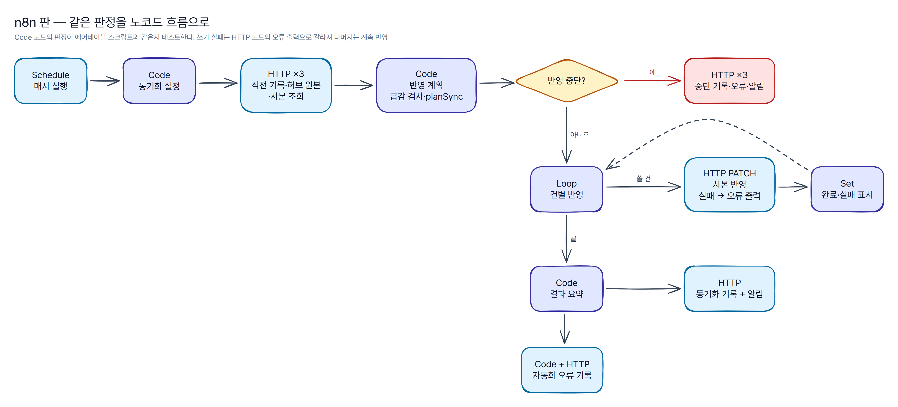

# n8n — 허브 → 사업부 동기화 안전장치

`sync-safety.json`은 에어테이블 스크립트 [`sync-safety.js`](../airtable/automations/scripts/sync-safety.js)와 같은 판정을 n8n 흐름으로 옮긴 워크플로다. 가상 회사 "그리드웰 빌딩서비스" 스키마 기준이며 자격증명은 비워 두었다.

*그림은 n8n 편집기 화면이 아니라 `sync-safety.json`의 노드 구성을 그린 도면이다(원본: [`docs/diagrams/n8n-flow.yaml`](../docs/diagrams/n8n-flow.yaml)). 이 워크플로는 실제 n8n 인스턴스에 가져와 실행해 보지 않았다.*

> PDF → LLM → JSON 추출 워크플로는 이 저장소에 다시 만들지 않았다. 공개 저장소 [`llm-doc-extraction-pipeline`](https://github.com/workzeroai/llm-doc-extraction-pipeline)의 `n8n/`을 본다.

## 가져오기

1. n8n 편집기 → 오른쪽 위 메뉴 → **Import from File** → `n8n/sync-safety.json`
2. **동기화 설정** Code 노드 맨 위 `SETTINGS`만 고친다: 허브·사업부 Base ID, 사업부 ID, 동기화할 테이블(`customers`·`buildings`·`staff` 중 하나), 알림에 붙일 이름. 테이블을 여러 개 동기화하려면 워크플로를 복제해 `tableKey`만 바꾼다.
3. 에어테이블을 부르는 **HTTP Request 노드 8개**(직전 동기화 기록 조회·허브 원본 조회·사본 조회·사본 반영·동기화 기록 저장·중단 기록·중단 오류 기록·오류 기록)에 *Airtable Personal Access Token* 자격증명을 고른다. 권한: 허브 `data.records:read`, 사업부 Base `data.records:read`·`data.records:write`.
4. **결과 알림**·**중단 알림** 노드의 URL(`https://hooks.example.com/REPLACE_WITH_YOUR_WEBHOOK`)을 디스코드·슬랙 수신 웹훅으로 바꾼다. 본문은 `{content, text}` 둘 다 보내므로 어느 쪽이든 받는다.
5. 사업부 Base에는 [`airtable/create-base.mjs`](../airtable/create-base.mjs)로 만든 `동기화 기록`·`자동화 오류` 테이블과 사본 테이블이 있어야 한다.

## 노드별 역할

| 노드 | 하는 일 | 에어테이블 스크립트 판 |
|---|---|---|
| 매시 실행 (Schedule) | 매시 정각 시작 | 자동화 일정 트리거 |
| 동기화 설정 (Code) | Base ID·테이블 이름·규칙 준비 | `input.config()` |
| 직전 동기화 기록 조회 (HTTP) | 같은 테이블의 마지막 정상 실행(ok·partial) 1건 | `previousCount()` |
| 허브 원본 조회 (HTTP) | 허브 테이블 전체, `offset`으로 페이지 끝까지 | `fetchHub()` |
| 사본 조회 (HTTP) | 사본의 `id`·`syncHash`·`hubMissing` | `selectRecordsAsync()` |
| 반영 계획 (Code) | **원본 급감 검사** + 건 단위 검증·변경 감지(`checkVolume`·`planSync`) | 같은 함수 |
| 반영 중단? (IF) | 급감이면 쓰지 않고 중단 기록·오류·알림 | `volume.verdict === 'abort'` |
| 건별 반영 (Loop) → 쓸 건? → 사본 반영 (HTTP PATCH) | 10건씩 돌며 생성(id로 업서트)·수정·사라짐 표시. **쓰기 실패는 오류 출력으로 갈라져** 그 건만 실패 표시하고 나머지는 계속 | `writeAll()`의 한 건씩 다시 쓰기 |
| 반영 완료·실패 표시 (Set) | 결과를 표시해 루프로 되돌림 | — |
| 결과 요약 (Code) | 생성·수정·변경 없음·건너뜀·실패·사라짐 → ok / partial | `summarizeRun()` |
| 동기화 기록 저장 → 결과 알림 (HTTP) | 다음 실행의 비교 기준 + 요약 알림 | `동기화 기록` 행 |
| 오류 행 만들기 → 오류 기록 | 건너뜀·실패를 자동화 오류 테이블에(최대 20건) | 같은 테이블 |

차이: n8n 판은 건물 사본의 `customer` 연결을 채우지 않는다(레코드 ID를 찾는 단계가 늘어나서). 연결은 에어테이블 자동화 A02("텍스트 ID → 연결 필드 채우기", [`catalog.md`](../airtable/automations/catalog.md))가 채운다.

## 고칠 때

Code 노드 원본은 [`code/`](code/)에 있다. `BEGIN GENERATED` 구간(동기화 규칙·공용 판정 코드 `airtable/automations/lib/sync-core.js`)은 스키마에서 채워지므로 고치지 않는다. 원본을 고친 뒤 `npm run airtable:build`로 `sync-safety.json`을 다시 만든다(노드 id는 이름에서 만든 UUIDv5라 다시 만들어도 같다).

`npm test`의 [`n8n/test/workflow.test.js`](test/workflow.test.js)가 확인하는 것:

- 가져오기 형식(노드 필수 키, 자격증명 없음, 연결 대상 존재, 실제 Base ID 없음)과 분기 구조(중단 분기, 오류 출력 분기, 루프 끝 → 요약)
- Code 노드 JS를 그대로 실행해 `lib/sync-core.js`와 같은 계획을 내는지
- **같은 시나리오 5개**(첫 실행, 검증 실패 + 쓰기 실패, 급감, 원본 0건, 소폭 감소)에서 n8n 판과 에어테이블 스크립트 판의 결과(상태·생성·수정·변경 없음·건너뜀·실패·사라짐, 건너뛴 건)가 같은지

이 워크플로는 구조 테스트와 Code 노드 실행 테스트까지 했고, 실제 n8n 인스턴스·에어테이블에서의 실행 검증은 하지 않았다.
