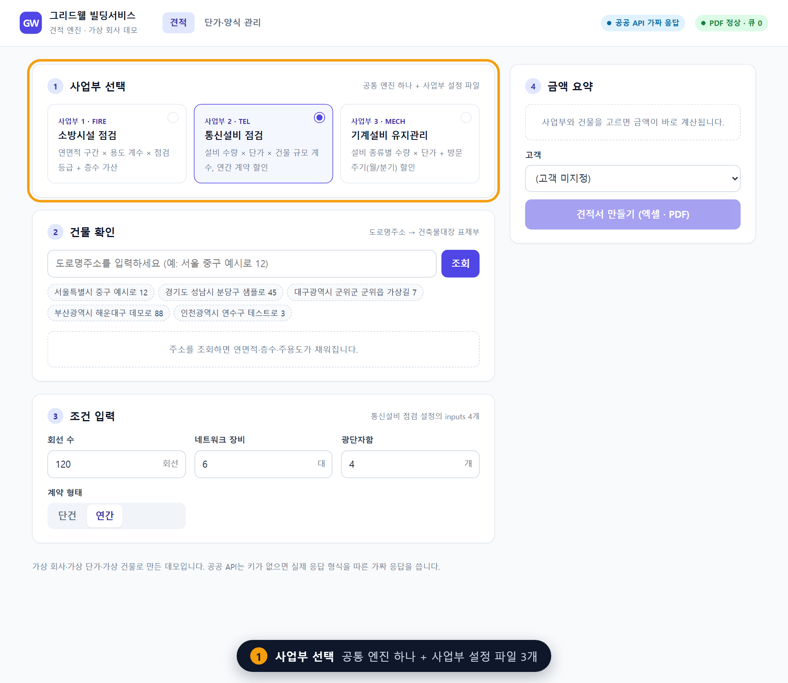
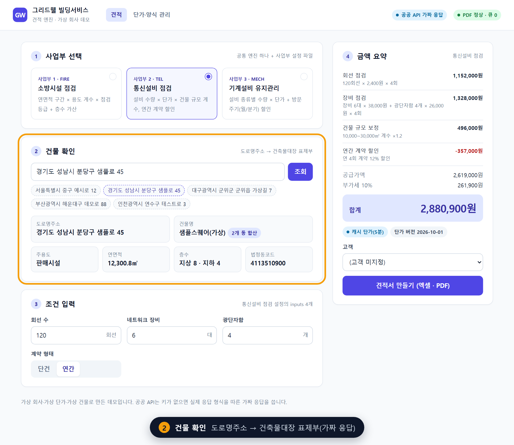
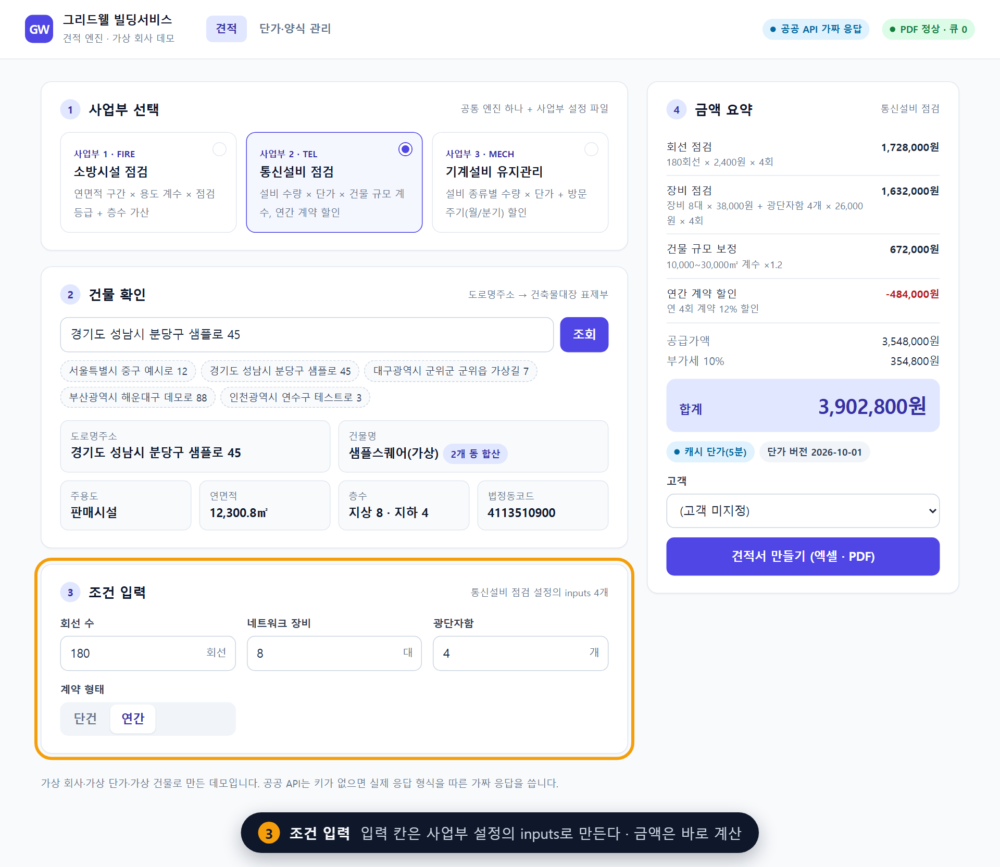
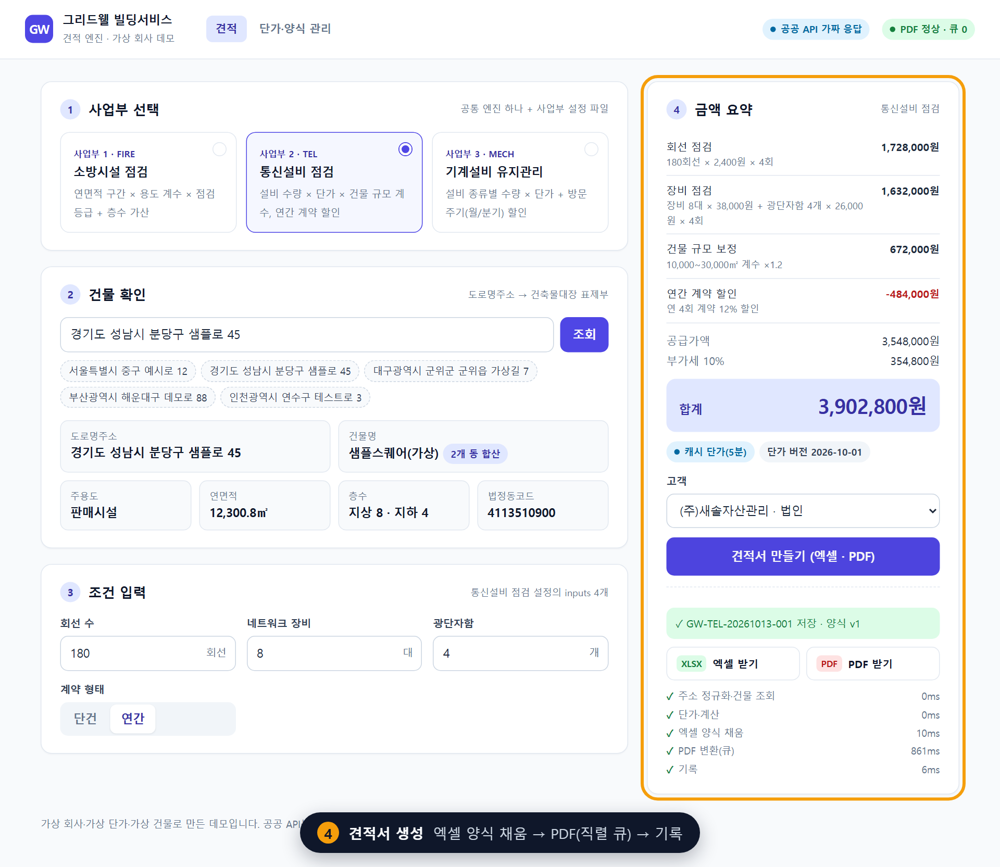
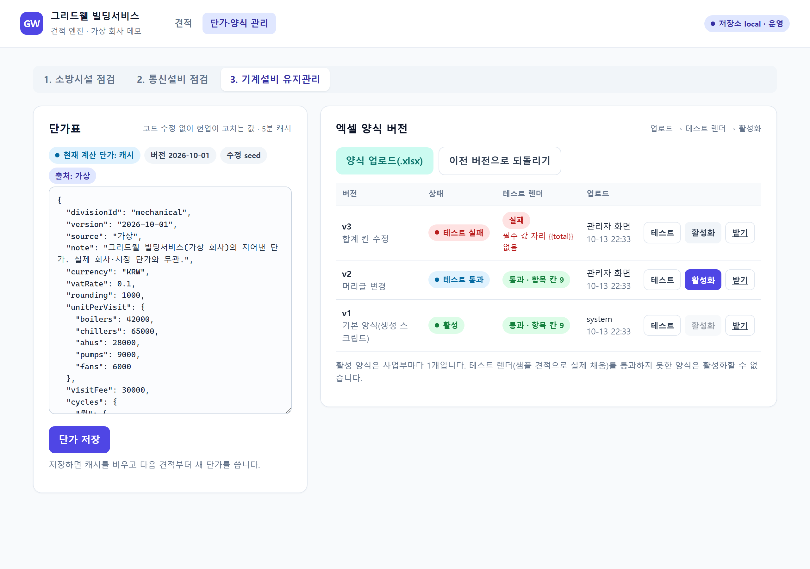
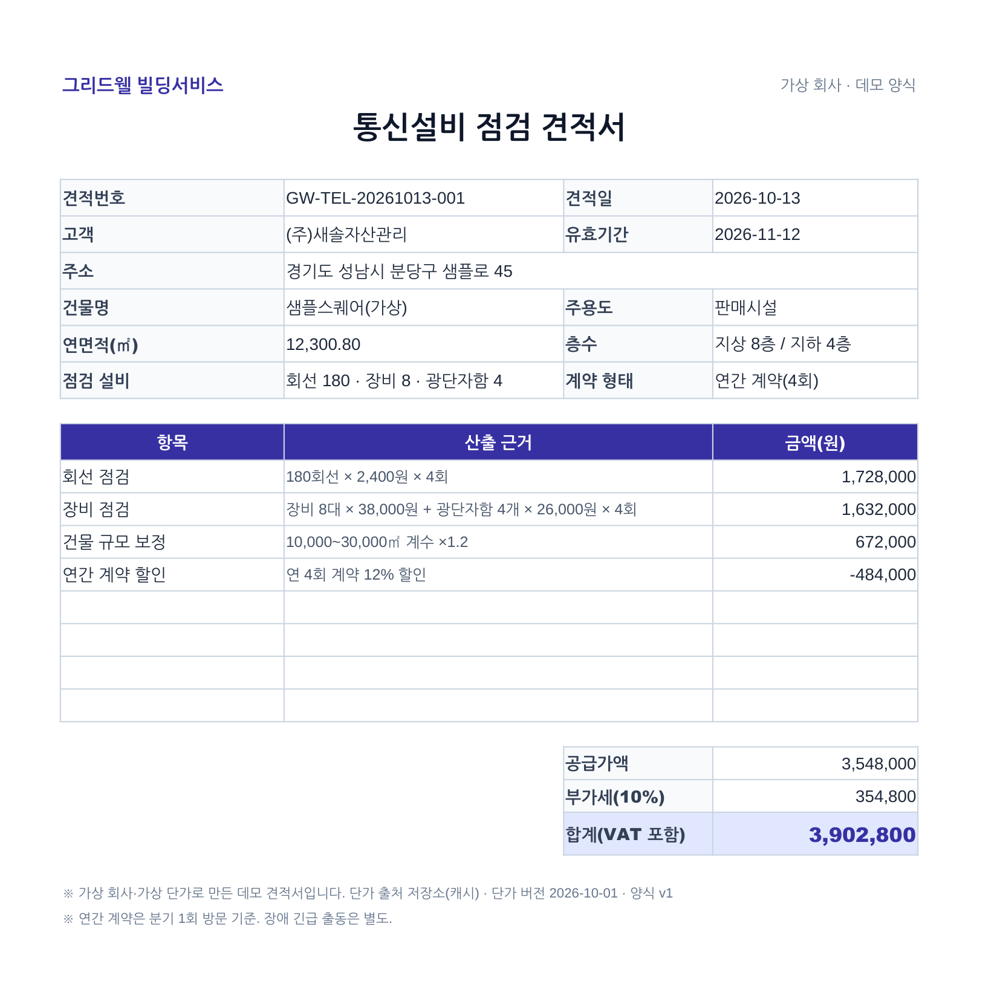
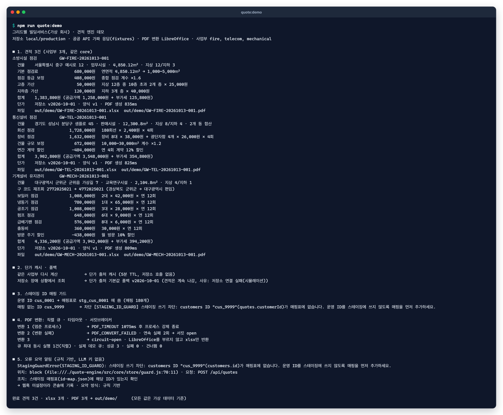

# quote-engine — 주소 하나로 견적서까지

> 주소를 넣으면 **건물 정보 조회 → 사업부별 규칙으로 금액 계산 → 엑셀 양식 채움 → PDF → 기록**까지 한 흐름으로 도는 견적 엔진.
> 가상 회사 "그리드웰 빌딩서비스"의 사업부 3개(소방·통신·기계)가 같은 core를 쓴다.

*회사·단가·양식·건물·고객은 모두 지어낸 가상 데이터입니다. 공공 API는 키가 없으면 실제 응답 형식을 따른 가짜 응답(fixtures)을 씁니다.*

| ① 사업부 선택 | ② 건물 확인 |
|---|---|
|  |  |
| **③ 조건 입력** | **④ 견적서 생성** |
|  |  |

| 관리자: 양식 업로드 → 테스트 → 활성화 | 생성된 PDF 견적서 |
|---|---|
|  |  |

견적 화면 전체: [`docs/shots/01-quote.png`](../docs/shots/01-quote.png) · 행정구역 개편 구 코드 재조회: [`docs/shots/02-legacy-code.png`](../docs/shots/02-legacy-code.png) · 장애와 안전장치의 관계: [docs/incidents.md](../docs/incidents.md)

## 빠른 실행

```bash
npm ci
npm run quote:demo   # 3개 사업부 견적 xlsx(+LibreOffice가 있으면 PDF)와 안전장치 시연
npm start            # http://localhost:3000  (관리자 /admin.html)
```

- Node 22 이상. LibreOffice가 없으면 PDF 없이 xlsx만 만들고 정상 종료한다(`SOFFICE_PATH`로 경로 지정 가능).
- 키 없이 전부 돈다. 선택 키는 [`.env.example`](../.env.example) 참고.



## 3층 분리

```text
quote-engine/src/
├─ core/                     # 공통 엔진: 사업부 이름을 모른다
│  ├─ pipeline.js            # 주소 정규화 → 건물 조회 → 단가 → 계산 → 엑셀 → PDF(큐) → 기록
│  ├─ registry.js            # divisions/*/config.js 자동 등록·형식 검사
│  ├─ normalize.js           # 주소 정규화, 도로명주소 응답 → 대장 조회 조건
│  ├─ building-client.js     # 도로명주소·건축물대장 표제부 클라이언트(가짜/실제), 구 행정코드 재조회
│  ├─ pricing.js             # 단가: 저장소 → 5분 캐시 → 번들 기본값 폴백
│  ├─ xlsx.js, templates.js  # 양식 생성·검사·채움, 버전 관리(업로드 → 테스트 렌더 → 활성화 → 되돌리기)
│  ├─ pdf-queue.js           # 직렬 큐 + 서킷브레이커
│  ├─ soffice.js             # LibreOffice 호출, 건당 타임아웃·프로세스 트리 강제 정리
│  ├─ circuit-breaker.js
│  ├─ notify.js              # 오류 3줄 요약(규칙 기반, 키가 있으면 LLM 선택) → 디스코드 형식 웹훅
│  └─ store/                 # 데이터 저장소: local(JSON)·airtable 어댑터 + 스테이징 ID 가드 + 데이터 계약 검사
├─ divisions/                # 사업부 설정: 입력 항목·출력 시트·calculateCosts·excelMapping·기본 양식 사양
│  ├─ fire/config.js         # 1번째
│  ├─ telecom/config.js      # 2번째
│  └─ mechanical/config.js   # 3번째 — 이 파일 + data/pricing/mechanical.json만 추가
├─ context.js                # 환경변수 → 구성 요소 조립(서버·데모 공용)
├─ server.js                 # Express API + 정적 화면
└─ public/                   # 견적 화면·관리자 화면(디자인 키트 토큰)
```

데이터(3층): [`data/pricing/*.json`](../data/pricing/)(번들 단가), [`data/seed/`](../data/seed/)(가상 고객·건물·견적·계약), [`data/schema/`](../data/schema/)(데이터 계약). 자세한 계약: [docs/data-contract.md](../docs/data-contract.md) · 사업부 추가 절차: [docs/adding-a-division.md](../docs/adding-a-division.md)

## 안전장치 — 1인 운영에서 장애를 구조로 막기

| 위험 | 장치 | 어디서 | 테스트 |
|---|---|---|---|
| 동시 요청에 LibreOffice가 멈춤·빈 파일 | PDF 변환 **직렬 큐**(동시 1건) | `core/pdf-queue.js` | `pdf-queue.test.js` 직렬 큐 |
| 변환 프로세스가 끝나지 않음 | 건당 **타임아웃**(기본 90초) 후 프로세스 트리 강제 종료, 다음 건 진행 | `core/soffice.js` `runWithTimeout`·`killTree` | 타임아웃 후 프로세스 생존 여부 확인 |
| 변환 실패가 계속됨 | **서킷브레이커**: 연속 3회 실패 → 60초 동안 PDF 생략·xlsx만 반환 → 시험 1건 → 복구. 상태 변경은 알림 | `core/circuit-breaker.js` | 열림·반열림·재열림 |
| LibreOffice 없음 | 경고 후 xlsx만(`pdfStatus: skipped`) | `core/pdf-queue.js` | |
| 단가를 고칠 때마다 배포 | 단가를 저장소로 **외부화**, 관리자 화면에서 수정(키 검사) | `core/pricing.js` | 수정 후 캐시 비움 |
| 저장소 장애로 견적 중단 | **5분 캐시** + 실패 시 **번들 기본값 폴백**, 응답·기록에 `pricingSource` | `core/pricing.js` | 캐시·TTL·폴백·복구 |
| 양식 변경으로 견적서가 깨짐 | 양식 **버전 관리**: 업로드 → 샘플로 **테스트 렌더**(필수 값 자리·시트·항목 칸·남는 값 자리) → 통과한 것만 **활성화**, 되돌리기 | `core/templates.js`, `core/xlsx.js` | 오타·시트 이름 변경·깨진 파일 거부 |
| 스테이징 작업이 운영 데이터 오염 | **스테이징 ID 가드**: 매핑표에 없는 ID로 쓰면 에러(로컬·에어테이블 어댑터 공통), 운영에 스테이징 ID 섞임도 차단 | `core/store/guard.js` | 두 어댑터 모두, 차단 시 API 미호출 |
| 행정구역 개편으로 건물 조회 실패 | 새 법정동코드로 대장이 비면 **구 코드로 재조회**, 건물 레코드에 기록 | `core/building-client.js` | 군위군(47720 → 27720) 예시 |
| 서버 오류를 늦게 앎 | 오류 스택을 **3줄 요약**해 웹훅 알림, 경로·키 가림, 같은 오류 10분 내 반복은 한 번만 | `core/notify.js` | 규칙·LLM·실패 대체·억제 |
| 계산 실수 | 항목 합 = 공급가액, 공급가액 + 부가세 = 합계, 정수 검사 | `core/pipeline.js` `checkResult` | |

오류 요약은 **규칙 기반이 기본**이다. `ANTHROPIC_API_KEY`가 있을 때만 LLM 요약을 시도하고, 실패·거절·형식 불일치면 규칙 기반으로 돌아간다. 알림에는 어떤 방식으로 요약했는지 적는다.

## API

| 메서드 | 경로 | 설명 |
|---|---|---|
| GET | `/api/divisions` | 사업부 목록(입력 항목 포함) |
| GET | `/api/building?address=` | 주소 → 건물 정보 |
| POST | `/api/quotes/preview` | 실시간 금액(파일·기록 없음) |
| POST | `/api/quotes` | 견적 생성(xlsx·PDF·기록) |
| GET | `/files/:name` | 생성 파일 받기 |
| GET | `/api/status` | PDF 큐·서킷·단가 캐시·가드 상태 |
| GET·PUT | `/api/admin/pricing/:divisionId` | 단가 조회·수정 |
| GET·POST | `/api/admin/templates/:divisionId` | 양식 버전 목록·업로드(자동 테스트 렌더) |
| POST | `/api/admin/template-versions/:id/{test,activate}` | 테스트 렌더·활성화 |
| POST | `/api/admin/templates/:divisionId/rollback` | 이전 활성 버전으로 |

## 테스트

```bash
npm test          # node:test
npm run coverage  # c8, 줄 80% 미만이면 실패
npm run lint      # ESLint
```

사업부별 계산(손계산 금액 고정) · 레지스트리(3번째 사업부를 core 수정 없이 로딩) · 단가 캐시·폴백 · 양식 테스트 렌더 실패 시 활성화 거부 · PDF 큐 직렬성·타임아웃·서킷브레이커 · 스테이징 가드(로컬·에어테이블) · 구 행정코드 재조회 · 오류 요약 알림 · 웹 API · 데이터 계약.
